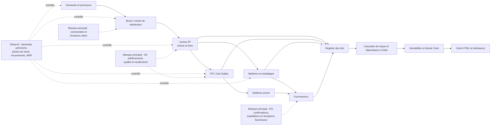

# Rapport de complétude de la simulation Etudecas

**État analysé : 16 octobre 2026**

**Référence nominale courante : `coherent-MRP-20261014`**
**Périmètre : chaîne complète, de la demande client aux fournisseurs, puis lots, risques, coûts, sensibilités et incertitudes**

## 1. Conclusion

Etudecas est aujourd'hui une simulation exécutable, reproductible et suffisamment riche pour étudier le comportement d'une chaîne logistique sur cinq ans. Elle représente la demande, Muret, les usines de produits finis, Gaillac, les matières et emballages, les fournisseurs, les transports, les stocks, le MRP, les lots, les cascades de risque, les sensibilités et l'incertitude.

Elle n'est cependant pas encore une reproduction complète de l'exécution industrielle de 2025. Les données disponibles décrivent correctement de nombreux **niveaux hebdomadaires**, des **plans MRP**, des **politiques**, des **nomenclatures** et des **conditions d'achat**. Il manque surtout les journaux transactionnels qui relient chaque décision à son exécution : ordres de fabrication, prélèvements matière, commandes fournisseur, transferts, statuts qualité et livraisons client.

Cette distinction explique une grande partie des difficultés rencontrées :

- le moteur sait calculer une chaîne cohérente ;
- les photos de stock et mouvements permettent de contrôler des bilans ;
- mais plusieurs causes physiques ont dû être **reconstruites** à partir de leurs effets ;
- les années 2026 à 2029 restent des **scénarios prospectifs**, car les observations industrielles portent essentiellement sur 2025.

Les **OF 2025** sont donc un manque majeur, mais ils ne suffisent pas à eux seuls. Pour fermer toute la simulation, il faut aussi les documents matière, les commandes fournisseur, les transferts physiques, les statuts de stock et qualité, les livraisons client et un état initial exhaustif au 1er janvier 2025.

## 2. Comment lire les résultats

Le rapport utilise cinq niveaux de preuve qui ne doivent pas être confondus.

| Niveau | Définition | Exemple |
|---|---|---|
| **Observé** | Valeur directement présente dans une source industrielle | Photo de stock hebdomadaire, besoin dans une version MRP |
| **Reconstitué** | Valeur calculée par bilan à partir de plusieurs observations | Entrée estimée à Muret à partir des stocks et sorties |
| **Convention** | Choix explicite nécessaire pour faire fonctionner le modèle | Composants des OF d'ouverture considérés déjà prélevés |
| **Calibré** | Paramètre choisi pour rapprocher le modèle des observations | Profil d'usage partagé déduit de `Scan3` et de la BOM |
| **Simulé** | Résultat produit par le moteur | Ordre calculé, stock futur, exposition d'un lot à un incident |

Une courbe proche des données réelles démontre une concordance sur les indicateurs, dates et périmètres comparés. Elle ne valide pas à elle seule le comportement global et ne prouve pas que chaque ordre, lot ou mouvement sous-jacent est historiquement exact.

## 3. Vue d'ensemble de la chaîne et des preuves

## 4. Données industrielles réellement disponibles

Les principales sources actives sont décrites dans [DONNEES_SOURCES.md](DONNEES_SOURCES.md). Leur rôle dans la simulation est résumé ci-dessous.

| Source | Contenu utile | Limite structurante |
|---|---|---|
| `268091.xlsx` | BOM de 15 composants et 23 conditions d'achat | Une référence/format étudié, pas toutes les BOM partageant les composants |
| `268967.xlsx` | BOM de 8 composants, 8 conditions d'achat, lien avec 773474 | Les différents formats commerciaux ne sont pas tous explicités |
| `773474.xlsx` | BOM de 773474 vers 021081 et données d'achat | Ne décrit pas toute l'exécution à Gaillac |
| `demand_PF.xlsx` | Ancienne série de 52 semaines par PF, conservée comme comparateur | Calendrier implicite ; `forecast_demand` et `real demand` sont identiques sur 104 lignes |
| `Flow_Data_Customer_Demand.xlsx` | Historique exécuté en 2025 et 13 versions de prévisions de 52 semaines par PF | Une prévision n'est pas une commande client exécutée ; le futur au-delà de la couverture source reste un scénario |
| `Flow_Data_Inventory_and_Replenishment_rules.xlsx` | 1 646 photos de stock, politiques et tailles de lot | Photos hebdomadaires ; statuts et transactions détaillées absents |
| `Flow_Data_Inventory_movements.xlsx` | 1 319 mouvements hebdomadaires signés | Plusieurs causes sont agrégées ; pas toujours de document, lot ou OF associé |
| `Flow_Data_MRP_results.xlsx` | 53 398 lignes, 52 versions, 33 couples article/site | Décrit des plans successifs, pas l'exécution ni tous les identifiants d'ordre |
| `Extract_En_cours.xlsx` | 104 positions présentes au démarrage, dont 22 `O.Proc` | Pas de numéro d'ordre, date de création, statut de lancement ou preuve de prélèvement matière |
| `CA_Perdu_Réel.csv` | CA livré et perdu par jour ouvré et PF | Pas de quantité livrée ni de prix unitaire permettant une conversion exacte |
| `Fournisseur.xlsx` et FIA | Identités, sites, prix, délais et quantités standards | Pas d'historique complet de performance ni de commandes exécutées |
| Audits et preuves publiques fournisseur | Questions d'audit et contexte documenté | Proxies et constats ponctuels, pas des fréquences de panne ou lois statistiques |

Sur les stocks, 31 couples article/site disposent de 53 photos en 2025. Le couple 344135/Gien n'en a que trois. Il n'existe pas de série hebdomadaire directe des stocks de 268091 à Avène et de 268967 à Gien avant leur expédition vers Muret.

## 5. Couverture complète de la simulation

### 5.1 Demande, service client et centre de distribution

| Sujet | Ce que la simulation sait faire | Preuve ou reconstruction actuelle | Ce qui manque | Priorité |
|---|---|---|---|---|
| Demande 2025 | Injecter la demande hebdomadaire datée par PF | `Flow_Data_Customer_Demand.xlsx / Historique / Actual Demand`, répartie en UN entières | Commandes client identifiées, dates demandées/promises, annulations et retours | P0 pour une reproduction au jour près |
| Prévisions | Utiliser la dernière prévision connue à la date de décision | 13 versions de 52 semaines/PF | Règle industrielle exacte de génération et de consommation de prévision | P1 |
| Service réel | Comparer demande source, sorties réelles agrégées et réponse simulée | `abs(Sorties I)` selon l'interprétation métier fournie, gardé distinct du registre simulé | Journal unitaire des livraisons, reliquats et backlog par commande | **P0** |
| Stock Muret | Comparer les stocks hebdomadaires des deux PF | Photos réelles et stock simulé | Disponible/réservé/bloqué, entrées et sorties brutes, cut-off des photos | **P0** |
| Usine → Muret | Simuler le push après libération qualité | Flux réel reconstitué par bilan du stock de Muret | Ordres de transfert, départs, arrivées, lots et cadence réelle | **P0** |
| Distribution client | Simuler l'expédition et le transport au client | Client agrégé et hypothèses de transport | Clients réels, canaux, priorités d'allocation, expéditions et preuves de livraison | P1 |

La comparaison principale ne transforme plus le CA livré/perdu en unités. Les
`Sorties I` restent un mouvement hebdomadaire agrégé : elles permettent un
rapprochement physique, mais ne mesurent pas directement le fill-rate ni l'OTIF
et ne remplacent pas un journal de livraisons clients.

### 5.2 Production des produits finis et semi-finis

| Sujet | Ce qui est disponible | Ce que la simulation reconstruit ou suppose | Ce qui manque | Priorité |
|---|---|---|---|---|
| OF ouverts au 1er janvier | 22 `O.Proc` dans `Extract_En_cours` | Initialisés comme WIP ; pour les 20 OF de 268091, les matières hors packaging sont supposées déjà incorporées | Identifiants, statuts, historique et preuve des prélèvements | **P0** |
| OF exécutés en 2025 | Indices dans les entrées, étuis et stocks | Productions PF et PFI estimées puis simulées | Journal exhaustif des OF, quantités bonnes/rebutées, dates et lots | **P0 absolue** |
| Capacité | Tailles de lots partielles ; indication d'environ 20 lots/semaine | Plusieurs lots possibles dans une campagne | Gammes, postes, temps de réglage/cycle, équipes, arrêts et rendement | P1 |
| Contrôle/libération PF | La durée du flux MRP est conservée ; l’utilisateur confirme que les contrôles PF se font à Muret | 10 jours ouvrés pour 268091 et 15 pour 268967, après arrivée physique au DC | Identifiants de lots qualité, dates horodatées d’entrée/libération/rejet | **P0** |
| Gaillac | Stocks, mouvements, MRP local, flux vers Avène/Gien | Modélisé comme usine et espace de stockage/redistribution | BOM réelle de 693055, OF, règles de couverture, frontière des délais 28/33/70 jours | **P0** |

Les 22 OF d'ouverture totalisent actuellement 1 945 715 unités de 268091, 600 kg de 693055 et 3 200 kg de 773474. Pour les 20 OF de 268091, le choix `wip` évite de prélever deux fois les matières hors packaging au 1er janvier ; les emballages sont prélevés pendant le conditionnement. La source ne prouve toutefois pas l'état réel de ces prélèvements.

### 5.3 Matières, emballages, nomenclatures et stocks

| Sujet | Couverture actuelle | Point non résolu | Conséquence | Priorité |
|---|---|---|---|---|
| BOM étudiées | 268091, 268967 et 773474 sont décrits | BOM de 693055, versions datées, substitutions et autres formats absents | Explosion théorique incomplète | **P0** |
| Consommations réelles | Pour MP/packaging, `Scan3` est confirmé comme nos références et `Sorties` comme les autres références ; les deux ferment de nombreux bilans | Étape exacte de Scan3 et rattachement OF/en-cours/format incomplets | L'écart Scan3/BOM de nos références reste inexpliqué | **P0** |
| Produits partagés | Certains articles sont explicitement partagés ; d'autres sont révélés par les écarts | Périmètre complet des autres produits/formats consommateurs | Risque de comparer un stock global à la seule BOM étudiée | **P0** |
| Matières/packaging | Le modèle conserve la BOM et ajoute séparément les usages partagés | Facteurs observés d'environ 4,55 à Avène et 4,83–4,95 à Gien entre registre et BOM étudiée | La cause ne doit pas être masquée par un multiplicateur arbitraire | **P0** |
| Statuts de stock | Physique, disponible et détenu sont séparés dans le moteur | Pas de journal réel complet par lot/emplacement/statut | Dates d'utilisation et de libération incertaines | P0/P1 |
| Quantités physiques | Les `UN` physiques doivent rester entières | Quelques données prévisionnelles peuvent être fractionnaires | Nécessite conversion et arrondi seulement au passage physique | Règle permanente |

L'écart matières/emballages ne signifie pas nécessairement une erreur de BOM.
Il ne doit plus être attribué aux autres références : celles-ci sont déjà dans
la colonne `Sorties`. Il peut encore provenir de l'étape d'enregistrement
Scan3, des OF/en-cours, d'une version ou base de BOM, d'une conversion d'unité
ou de rebuts. Tant que les OF, les versions de BOM et les documents matière ne
sont pas liés, la cause reste ouverte et aucun multiplicateur 4,55 n'est admis.

### 5.4 MRP, achats, fournisseurs et transports amont

| Sujet | Couverture actuelle | Manque | Impact | Priorité |
|---|---|---|---|---|
| Calcul MRP | Besoin net, protections, horizon glissant, lots, délais, commandes connues et replanification sont simulés | Paramètres datés complets, zones gelées, firming, messages d'exception et interventions manuelles | Décision hebdomadaire plausible sans identité exacte de chaque ordre | **P0** |
| Commandes fournisseur | Prix, délais et quantités standards existent pour 35 conditions FIA | PO/lignes 2025, date de création, confirmation, report, ASN, réception, annulation et prix réel | Impossible de mesurer la performance fournisseur ou le recours réel au secours | **P0** |
| Multi-sourcing | Principal/secours établi pour 001848 | Règles et quotas complets pour les autres références | Choix fournisseur encore conventionnel sur plusieurs matières | P0/P1 |
| Délais fournisseur | Délais prévisionnels utilisés de façon déterministe dans le nominal | Dates promises et reçues permettant une distribution empirique | Scénarios de retard non calibrés sur une vraie population de commandes | P1 |
| Transferts intersites | Volumes annuels cohérents : 67 200 kg de 773474 et 13 190 kg de 693055 | Ordres de transfert, lots, palettes/camions, départ et réception | Calendrier et stock en transit restent estimés | P1 |
| Transport | Routes et délais existent dans le graphe | Cadence, calendrier, groupage, capacité et historique d'incidents | Effet sensible sur ruptures et dates, moindre sur les cumuls sans perte | P1 |

Le système MRP courant est une référence de simulation : ses règles sont détaillées dans [REGLES_MRP.md](REGLES_MRP.md). Les 52 versions industrielles permettent de retrouver beaucoup de besoins projetés et de déplacements de dates, mais pas toujours la création, le statut ferme ou la modification de chaque ordre individuel.

### 5.5 Lots et traçabilité

La simulation dispose de deux lectures complémentaires qu'il faut conserver :

1. le suivi historique détaillé d'un lot, avec ses mouvements et ses états ;
2. l'exploration interactive simplifiée, qui remonte ou descend la chaîne entre matières, productions, transports et clients.

La généalogie simulée peut relier un lot fournisseur à une consommation, un lot de production, une expédition et une exposition client. La généalogie **réelle 2025** ne peut pas être certifiée sans :

- identifiants des lots entrants et produits ;
- prélèvements matière par OF ;
- liens vrac/PFI/conditionnement/PF ;
- mouvements et changements de statut horodatés ;
- lots portés par chaque transfert et chaque livraison.

La lotification simulée est donc utile pour tester des incidents futurs. Elle ne doit pas être présentée comme la généalogie historique de 2025 lorsque le lien industriel n'est pas fourni.

Pour Cicalfate, la règle active impose un minimum de 28 800 unités, un multiple de 14 400, un maximum réalisable de 129 600 et un plafond déclaré de 142 485. Ces valeurs restent des règles de simulation issues des informations disponibles, et 14 400 n'est pas une taille de lot unique. Les sources actuelles ne prouvent pas à elles seules le multiple de palette, la capacité de cuve, le rendement ou l'identité des lots physiques. De même, un `shipment_id` de la simulation désigne une transaction logistique simulée ; il ne prouve pas l'existence d'un camion réel.

### 5.6 Risques, dépendance à l'état, fournisseurs et incertitude

| Fonction | Ce qui est opérationnel | Limite actuelle |
|---|---|---|
| Cascades de risque | Implémentées comme études séparées : normal, incident non traité et solution, avec contrôle de l'application physique | Scénarios synthétiques ; aucun incident n'est appliqué dans la carte nominale courante ; l'impact incrémental exige un contrefactuel apparié |
| Dépendance à l'état | Implémentée avec seuils, états et boucles de rétroaction | Seuils et coefficients encore peu calibrés ; la campagne canonique consultée désactive actuellement `state_dependent_risks` |
| Sensibilités | Implémentées comme études séparées sans modifier le nominal | Leurs payloads ne sont pas attachés à la carte courante ; une sensibilité mesure une réponse du modèle, pas une probabilité industrielle |
| Monte Carlo | Propagation de distributions d'entrée vers les indicateurs de sortie, comparaisons appariées et diagnostics de variance | Non lancé dans la carte courante ; les distributions manquent souvent d'assise empirique et la décomposition disponible est une importance prédictive, pas un indice de Sobol |
| Criticité fournisseur | Campagne implémentée à partir de la structure, de l'exposition et des alternatives | Métriques non attachées à la carte courante ; le proxy à quatre semaines exprime une pression de risque, pas une probabilité d'incident |
| Contexte public fournisseur | Preuves publiques et signaux documentés | Ce sont des indices de contexte, pas des fréquences de défaillance |
| Audit fournisseur | Deux trames sont présentes | Elles contiennent 337 cellules non vides différentes, comprenant réponses et scores, ainsi que de nombreuses formules, sans date ni auditeur confirmés ; aucun audit ne doit encore être présenté comme fait officiel |

Pour ces modules, la séparation suivante est essentielle :

- le **nominal** conserve les données et règles sources ;
- les **sensibilités** modifient explicitement une hypothèse ;
- les **stress tests** explorent un incident possible ;
- le **Monte Carlo** propage des distributions annoncées ;
- aucune de ces couches ne transforme une hypothèse en observation industrielle.

### 5.7 Coûts et indicateurs économiques

Les prix d'achat des FIA permettent de valoriser une partie des approvisionnements. Le moteur chiffre les achats, les transports, les stocks, la production et les approvisionnements exceptionnels. La rupture et la perte de service sont mesurées en backlog, unités non servies et quantité-jours ; elles ne forment pas encore un coût monétaire complet faute de prix net de vente. Il manque aussi les prix réellement facturés par commande, les coûts logistiques complets, les coûts de capacité/arrêt et les coûts qualité.

Les résultats économiques doivent donc distinguer :

- **coût d'achat externe observé ou issu de la fiche achat** ;
- **coût opérationnel modélisé** ;
- **CA livré/perdu observé** ;
- **service simulé en unités et backlog**, séparés du CA observé.

Le parcours actif ne calcule pas actuellement d'indicateur environnemental. Une extension environnementale exigerait au minimum les distances réelles, modes, poids bruts, remplissages, facteurs d'émission, énergie de stockage/production et un périmètre d'analyse de cycle de vie explicite.

### 5.8 Carte HTML, résultats et reproductibilité

La carte nominale complète affiche le réseau, les courbes, les comparaisons industrielles 2025, les résumés sur cinq ans et les deux suivis de lots. La référence courante est reconstruisible depuis le bundle compact de configuration. Les résultats lourds ne sont pas nécessaires dans Git lorsque la régénération est documentée.

Les interfaces prévues pour les risques, sensibilités, Monte Carlo et criticités existent, mais leurs campagnes ne sont pas attachées à la carte nominale courante. La comparaison de scénarios n'y contient que la référence nominale. Ces capacités logicielles ne doivent donc pas être confondues avec des résultats actuels déjà exécutés et qualifiés.

Les limites d'affichage sont les mêmes que celles du calcul : une courbe reconstituée doit rester étiquetée comme telle ; une absence de donnée ne doit jamais devenir zéro ; une prévision, un ordre réservé et une exécution doivent rester distincts.

Les registres documentaires ne sont pas encore tous alignés sur la même référence : `docs/reference/mrp_current.json` et `docs/reference/current.json` peuvent encore désigner des références antérieures. Cette gouvernance doit être remise à niveau après stabilisation et qualification du prochain point de référence.

## 6. Ce que nous avons dû reconstruire

Les principaux éléments reconstruits pendant les travaux sont :

1. la réponse réelle agrégée à partir des mouvements PF `Sorties I`, sans conversion du CA en unités ;
2. les entrées à Muret et, par décalage, les sorties d'usine, à partir des bilans de stock ;
3. une partie des productions PF à partir des emballages, des stocks et des flux ;
4. certaines productions de PFI à Gaillac par bilan matière ;
5. les usages des autres références à partir de la colonne `Sorties I` pour les matières et emballages ; l'écart Scan3/BOM reste un diagnostic non réaffecté ;
6. le pipeline d'ouverture et le statut matière probable des 22 `O.Proc` ;
7. les décisions MRP probables à partir de 52 photographies successives du plan ;
8. les règles principal/secours et certaines conventions de regroupement de commandes ;
9. les dates de transfert et de libération à partir des dates visibles aux deux extrémités ;
10. la double fonction de Gaillac, usine et hub de matières/PFI ;
11. les paramètres de transport et de lotification lorsqu'aucun document physique n'était fourni ;
12. les années 2026–2029 par répétition du profil saisonnier, croissance et calendriers supposés.

Ces reconstructions doivent être conservées comme apprentissage et comme solution provisoire. Elles doivent être remplacées par des observations si les exports industriels deviennent disponibles.

## 7. Données qui manquent pour une simulation complète

### 7.1 Priorité P0 — fermer les bilans et l'exécution 2025

#### A. Ordres de fabrication 2025

Un export complet doit contenir au minimum :

- `OF_ID`, site, article parent, format, version de production et lot parent ;
- quantités prévue, lancée, confirmée bonne, rebutée, retouchée et restante ;
- dates planifiées et réelles de création, firming, libération, début, fin, clôture, entrée et sortie de contrôle qualité ;
- historique horodaté des statuts ;
- gamme, opération, ligne/poste, équipe, temps de réglage, cycle et arrêt ;
- composants réservés, prélevés, retournés et rebutés avec date, lot, emplacement et statut ;
- généalogie composant → vrac/PFI → conditionnement → PF ;
- ordre de transfert ou livraison associé.

#### B. Documents matière et statuts de stock

Chaque transaction devrait fournir : identifiant, date/heure, site, emplacement, article, lot, quantité, unité, type/motif, statut avant/après et OF/PO/transfert lié.

#### C. Commandes fournisseur 2025

Pour chaque PO/ligne : fournisseur, article/site, création, demande, confirmation, expédition, réception, disponibilité, quantités commandée/confirmée/expédiée/reçue/rejetée, prix, statut et motif de report.

#### D. Transferts physiques

Pour les liaisons intersites et usine→Muret : ordre, livraison, origine, destination, lot, quantité, palette/camion, départ, arrivée, réception et statut.

#### E. Commandes et livraisons client

Par ligne : quantité commandée, date demandée, date promise, quantité préparée/expédiée/reçue, reliquat, annulation, retour, client/canal et prix net. C'est le seul moyen de mesurer directement le service en unités, le backlog et l'OTIF.

#### F. État exhaustif au 1er janvier 2025

Stocks par statut et emplacement, WIP par OF, composants déjà prélevés, commandes fournisseur ouvertes, transferts en transit, produits en contrôle, allocations Muret et commandes client en retard.

#### G. Référentiels datés

BOM et gammes de tous les formats et produits partageant les composants, versions/effectivités, substitutions, paramètres MRP, listes de sources et quotas. La BOM réelle de 693055 est prioritaire.

### 7.2 Priorité P1 — expliquer les dates et les écarts d'exécution

- lots et événements qualité : prélèvement, entrée contrôle, libération, rejet et motif ;
- calendriers de capacité par site/ligne, équipes, fermetures, maintenance et changements de format ;
- calendriers fournisseur et transport, cadences, groupages et capacités ;
- paramètres MRP datés : sécurité, lot, MOQ, multiple, horizon, gel, firming, consommation de prévision, traitement et source list ;
- performances fournisseur : dates demandées, confirmées et réelles, réception partielle, qualité et capacité contractuelle ;
- règles réelles d'allocation en pénurie et segmentation des clients.

### 7.3 Priorité P2 — calibrer les études prospectives

- prévisions et changements de portefeuille 2026–2029 ;
- évolutions de capacités, fournisseurs, prix et politiques ;
- historique d'incidents avec durée, cause, dépendances et pertes ;
- corrélations et distributions empiriques pour le Monte Carlo ;
- coûts complets d'immobilisation, transport, urgence, arrêt, qualité et rupture ;
- audits fournisseur datés, preuves, actions et résultats.

## 8. Ce que les OF 2025 résoudraient — et ne résoudraient pas

Les OF permettraient de remplacer les productions estimées par les productions réellement lancées, terminées, libérées et rebutées. Ils clarifieraient les 22 ordres d'ouverture, les tailles de campagne, les séquences, le WIP, les rendements, les passages vrac/conditionnement et une grande partie du facteur entre BOM étudiée et consommation enregistrée.

Ils ne résoudraient pas seuls :

- la création et l'exécution des commandes fournisseur ;
- les stocks bloqués, réservés ou en transit sans documents matière ;
- les transferts physiques et transports ;
- les règles de décision MRP, interventions manuelles et zones gelées ;
- la demande, la livraison client et le service réel ;
- les BOM des autres formats absents ;
- les probabilités de risque et performances fournisseur.

## 9. Priorités de travail

### Priorité 1 — figer la vérité disponible

Conserver la référence `coherent-MRP-20261014`, aligner les registres de référence, et produire pour chaque courbe une provenance explicite : observée, reconstituée, calibrée ou simulée.

### Priorité 2 — obtenir le paquet P0

La demande de données doit porter ensemble sur les OF, documents matière, PO, transferts, livraisons client, état initial et référentiels datés. Demander uniquement les OF laisserait encore plusieurs ruptures de chaîne.

### Priorité 3 — construire un rejeu 2025 fermé

Le rejeu doit utiliser les événements exécutés pour valider séparément :

1. la décision MRP ;
2. l'exécution achats/production ;
3. la qualité et la disponibilité ;
4. les transferts et transports ;
5. le service client.

### Priorité 4 — recalibrer sans contaminer le nominal

Les écarts restants doivent être traités comme hypothèses testables. Les sensibilités, variantes de stock de sécurité et lois de délai doivent rester hors du nominal tant qu'elles ne sont pas confirmées par une source.

### Priorité 5 — réestimer les risques et l'incertitude

Une fois les journaux transactionnels disponibles, recalculer délais, rendements, retards, réceptions partielles, durées qualité et corrélations. Les scénarios actuels resteront utiles comme stress tests et pourront être comparés aux distributions empiriques.

## 10. Critères d'une simulation « complète »

La simulation pourra être considérée comme complète pour 2025 lorsque :

- chaque stock initial est expliqué par statut, emplacement et lot ;
- chaque production est reliée à un OF et à ses consommations ;
- chaque commande fournisseur et transfert possède une identité et un historique ;
- chaque changement de stock est rapproché d'un mouvement source ;
- les quantités demandées, livrées, perdues et en retard sont disponibles en unités ;
- la généalogie matière → PFI → PF → expédition fonctionne dans les deux sens ;
- les bilans article/site se ferment sans correction résiduelle inventée ;
- les paramètres MRP et référentiels sont datés et applicables à la bonne semaine ;
- les écarts stock, flux, dates et service respectent des tolérances définies avant le rejeu ;
- les années futures sont clairement identifiées comme scénarios et non observations.

## 11. Limites de ce rapport

Ce rapport consolide les sources documentées, la configuration active et les analyses existantes. Il ne relance pas la simulation et ne transforme aucune hypothèse en fait industriel. Les invariants techniques prouvent la cohérence du calcul ; ils ne certifient pas la calibration industrielle.

Références principales : [bilan des données sources](DONNEES_SOURCES.md), [règles MRP](REGLES_MRP.md), [couverture et limites](COVERAGE_AND_LIMITS.md), [matières, lots et incidents](MATIERES_LOTS_ET_INCIDENTS.md), [lots et transports](LOTS_ET_CAMIONS.md), [comparaison de scénarios](SCENARIO_COMPARISON.md), [provenance](PROVENANCE.md) et configuration `etudecas/config/mrp_reference_20261013/`.
