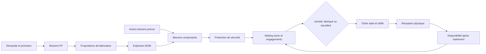
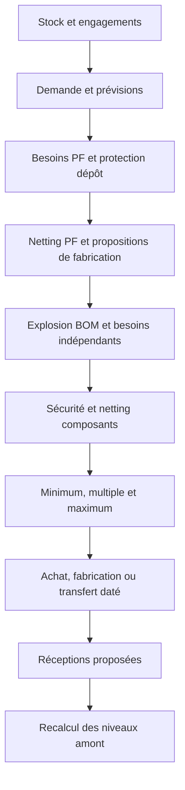

# Système MRP courant

Ce document décrit uniquement les règles actives de la référence MRP. La
chronologie des essais, hypothèses rejetées et limites rencontrées est conservée
dans [l'expérience MRP 2025](archive/MRP_EXPERIENCES_2025.md).

La référence nominale courante utilise `coherent_scenario`. `source_priority`
reste disponible comme comparaison antérieure explicite. Les données industrielles
valident 2025 ; les années suivantes sont un scénario prospectif déclaré.

## Principe

Le calcul remonte de la demande client vers Muret, les usines de produits finis,
les semi-finis et les fournisseurs. Il est recalculé chaque jour sur 364 jours.



Prévu, engagé et exécuté restent distincts. Une proposition est révisable ; une
commande, fabrication ou expédition lancée devient une réception ferme. Une
libération déplace du stock détenu vers le disponible sans seconde entrée.

## Demande et prévision

```text
prévision restante = max(0, prévision hebdomadaire - demande déjà arrivée)
prévision future(semaine, cycle) = prévision base(semaine) × 1,05^cycle
```

Un cycle vaut 52 semaines, soit 364 jours. Les UN futures sont entières. Une
quantité hebdomadaire `Q` est distribuée sans fraction physique :

```text
Q_j = floor(Q × (j + 1) / 7) - floor(Q × j / 7)
```

La somme des sept jours vaut exactement `Q`. Dans `coherent_scenario`, la
prévision MRP future et la demande physique emploient le même profil.

## Besoins bruts et BOM

```text
besoin brut PF(t) = prévision restante PF(t) + retard client(t)
coefficient BOM(c,p) = quantité composant BOM / taille de base BOM
besoin composant(c,t) = somme_p(fabrication prévue(p,t) × coefficient BOM(c,p))
                        + autres besoins prévus(c,t)
```

Le besoin composant est daté au lancement prévu de la fabrication parente. Une
campagne en cours est créditée une fois comme réception future ; ses composants
encore nécessaires sont demandés une fois.

## Protection de sécurité

Pour un achat externe :

```text
date protégée = date besoin - jours de sécurité ouvrés
enveloppe achat(t) = besoins anticipés cumulés(t) + stock fixe source
```

Pour les fabrications, transferts et dépôts :

```text
protection(t) = max(stock fixe,
                    besoins prévus dans la fenêtre de sécurité)
enveloppe(t) = max(enveloppe(t-1), besoins cumulés(t) + protection(t))
besoin de protection(t) = enveloppe(t) - enveloppe(t-1)
```

Muret utilise 100 % des jours retenus : 20 jours ouvrés pour 268091 et 25 pour
268967. La sécurité est une cible de planification, jamais une consommation.

## Besoin net

Les besoins sont triés par échéance ; stock et réceptions sont affectés FIFO
selon leur date de disponibilité.

```text
position projetée(t) = stock utilisable
                     + réceptions fermes disponibles avant t
                     + propositions disponibles avant t
                     - besoins cumulés avant t

besoin net(t) = max(0,
                    besoins restant à couvrir(t) + protection(t)
                    - stock utilisable - engagements couvrants(t)
                    - surplus des lots antérieurs)
```

Commandes confirmées, fabrications en cours, transferts engagés et stocks détenus
avec date de libération sont déduits une seule fois. Une réception tardive reste
une couverture tardive ; elle ne déclenche pas automatiquement un doublon.

## Lots et arrondis

```text
q1 = max(besoin net arrondi, minimum)
q2 = ceil(q1 / multiple) × multiple          si un multiple existe
q3 = ceil(q2)                                pour une UN physique
q_lot = min(q3, maximum)                     si un maximum existe
```

Plusieurs lots sont créés si nécessaire. Le surplus couvre les besoins suivants.
Le maximum borne un lot, pas le volume annuel. Les masses utilisent le quantum
configuré, arrondi au plus proche, demi vers le haut. Le regroupement d'achat
actif est d'un jour.

| Article | Minimum / multiple / maximum |
|---|---|
| 268091 | 28 800 UN / 14 400 UN / 142 485 UN ; lot multiple maximal 129 600 UN |
| 268967 | lot de 107 800 UN |
| 773474 | lot de 3 200 kg |
| 693055 | lot de 600 kg |

## Dates d'achat

```text
date protégée = date besoin - sécurité ouvrée
arrivée physique visée = date protégée - traitement réception ouvré
dernière date de commande = arrivée physique visée - délai fournisseur
date commande = max(date de décision, dernière date de commande)
date disponible = date commande + délai fournisseur
                  + traitement réception ouvré
```

Avec un calendrier explicite, le MRP prend le dernier départ tenant l'échéance.
Si elle est impossible, il choisit le premier départ encore possible et conserve
le retard. Les délais fournisseurs nominaux sont déterministes ; aucun tirage
Erlang n'est actif.

## Fournisseurs

Le fournisseur suit la politique du couple article/site : fournisseur désigné,
parts configurées ou principal/secours. Le moins cher n'est pas universel.

| Rôle 001848/Avène | Fournisseur | Prix | Délai | Standard |
|---|---|---:|---:|---:|
| Principal | VD0951020A | 1,58 €/kg | 56 jours | 6 000 kg |
| Secours | VD0519670A | 4,20 €/kg | 21 jours | 4 000 kg |

```text
manque avant principal = max(0,
  besoins avant disponibilité du principal
  - stock - réceptions fermes avant cette date)
```

Le secours couvre ce manque seulement s'il améliore la date. Sa quantité est
déduite avant de recalculer le principal.

## Fabrication

```text
q_max_composant(c) = stock utilisable(c) / coefficient BOM(c)
q_max_matières = min_c(q_max_composant(c))
q_lancement(t) = min(quantité due,
                     q_max_matières,
                     capacité restante du jour,
                     quota de lots restant)
```

Un lancement nul reste une proposition. La BOM est consommée pendant le travail.
Un lot incomplet reste en cours ; le produit physique n'est créé qu'à la fin.
`tau_process` reste une marge de planification, pas une durée physique confirmée.

Les capacités connues sont 203 550 UN/jour à Avène et 154 000 UN/jour à Gien.
La référence courante autorise jusqu'à 20 lots de production par semaine pour
268091 à Avène, 268967 à Gien et 773474 à Gaillac, conformément à la règle
métier confirmée. Cette limite borne le nombre de lancements, pas la taille
physique de chaque lot.

## Libération et transferts

```text
besoin transfert(t) = max(0,
  besoins destination(t) + protection destination(t)
  - stock destination - transferts déjà engagés)
date départ = date besoin - traitement destination - transport
date disponible destination = date départ + transport + traitement destination
```

Le stock est réservé à l'origine, débité au départ, mis en transit, reçu puis
libéré. Fabrication et transfert peuvent avoir des multiples différents.

| Flux | Libération origine | Transport | Traitement destination |
|---|---:|---:|---:|
| 268091 Avène → Muret | 10 jours ouvrés | environ 2,5 jours | politique du flux |
| 268967 Gien → Muret | 15 jours ouvrés | environ 2,5 jours | politique du flux |
| 773474 Gaillac → Gien | 33 jours ouvrés | 10 jours | 6 jours ouvrés |
| 693055 Gaillac → Avène | 28 jours ouvrés | 7 jours | 7 jours ouvrés |

Les PF libérés sont poussés vers Muret sous contraintes physiques. Le délai FIA
de 70 jours de 693055 reste non réconcilié avec la chaîne actuelle ; il n'est
pas transformé arbitrairement en délai de camion.

## Initialisation

```text
besoin net(t) = max(0,
  besoin protégé(t) - stock initial - réceptions fermes initiales(t))
```

Stocks et ordres présents au 1er janvier sont chargés une fois et jamais répétés.
Les matières des OF initiaux sont considérées déjà prélevées, hors étapes de
conditionnement explicitement représentées ; ce statut reste une hypothèse.

## Ordre du calcul



`coherent_scenario` garantit que le MRP et la demande physique future emploient
le même scénario. Il ne garantit pas la demande industrielle réelle 2026–2029.

Code principal :

- `etudecas/simulation/current_reference.py` ;
- `etudecas/simulation/engine/mrp_planning.py` ;
- `etudecas/simulation/engine/run_first_simulation.py` ;
- `etudecas/config/mrp_reference_20261013.json`.
