# Règles du système MRP courant

Ce document décrit le calcul actif de la référence **`coherent-MRP-20261014`**.
Il suit le flux dans son ordre métier : **demande client → besoin de produit fini →
fabrication → besoins de composants → ordre interne ou commande fournisseur**.

La chronologie des essais et des règles abandonnées reste dans
[l’expérience MRP 2025](archive/MRP_EXPERIENCES_2025.md). Elle ne définit pas le
comportement courant.

## Convention unique des variables

Une variable garde ci-dessous **le même nom, le même sens, la même unité et le
même périmètre à toutes les étapes**. Les noms techniques des CSV sont seulement
des alias de preuve ; ils ne redéfinissent jamais la variable métier.

### Indices et calendriers

| Symbole | Sens unique |
|---|---|
| `t` | jour où le MRP recalcule le plan ; « aujourd’hui » |
| `d` | date physique à laquelle un besoin doit être couvert |
| `w` | semaine civile considérée |
| `n` | nœud ou site de la supply chain |
| `i` | article quelconque |
| `p` | produit parent fabriqué |
| `c` | composant de `p` |
| `f` | fournisseur |
| `o` | ordre, proposition ou engagement identifié |
| `j_ouv_LV` | jours ouvrés du lundi au vendredi |
| `j_cal` | jours calendaires |

Le suffixe `|t` signifie « avec les informations connues au jour `t` ».
`obs` désigne une observation industrielle et `sim` une exécution simulée. Une
projection après 2025 ne porte jamais le suffixe `obs`.

### Quantités

| Variable canonique | Définition unique | Unité |
|---|---|---:|
| `Q_dem[n,p,t]` | demande client arrivée au jour `t` | unité de `p` |
| `Q_requis[n,p,t]` | demande du jour plus retard client antérieur | unité de `p` |
| `Q_retard[n,p,t]` | demande arrivée mais pas encore servie en fin de jour | unité de `p` |
| `Q_servi[n,p,t]` | quantité effectivement servie au client dans le scénario | unité de `p` |
| `Q_prev_sem[n,p,w|t]` | prévision de la semaine `w` connue au jour `t` | unité de `p` |
| `Q_prev_rest[n,p,w|t]` | part de cette prévision pas encore remplacée par la demande arrivée | unité de `p` |
| `q_prev_jour[n,p,d|t]` | part journalière future de `Q_prev_rest` | unité de `p` |
| `Q_besoin_brut[n,i,d|t]` | besoin physique daté avant sécurité, stock et engagements | unité de `i` |
| `Q_besoin_cum[n,i,d|t]` | cumul des besoins bruts jusqu’à `d` | unité de `i` |
| `Q_plancher_fix[n,i]` | réserve fixe source ajoutée une seule fois au plan | unité de `i` |
| `Q_plancher[n,i,d|t]` | réserve que le plan veut encore conserver après le besoin | unité de `i` |
| `Q_enveloppe[n,i,d|t]` | besoin cumulé protégé, rendu non décroissant | unité de `i` |
| `Q_besoin_protege[n,i,d|t]` | tranche de besoin de planification protégée à couvrir à `d` ; sa construction dépend du mode d’approvisionnement | unité de `i` |
| `Q_stock_util[n,i,t]` | stock présent, libéré, non déjà consommé ou réservé | unité de `i` |
| `Q_stock_detenu[n,i,t]` | stock présent mais encore inutilisable | unité de `i` |
| `Q_stock_reserve[n,i,t]` | stock présent et affecté à un mouvement futur | unité de `i` |
| `Q_stock_phys[n,i,t]` | stock total physiquement présent | unité de `i` |
| `Q_ferme[o]` | quantité d’un OF, transfert ou achat déjà engagé | unité de `i` |
| `Q_allouee[n,i,d|t]` | stock et engagements fermes affectés une seule fois au besoin `d` | unité de `i` |
| `Q_non_couvert[n,i,d|t]` | besoin protégé restant après l’allocation ferme | unité de `i` |
| `Q_surplus[n,i,d|t]` | excédent de lots proposés plus tôt encore utilisable | unité de `i` |
| `Q_besoin_net[n,i,d|t]` | quantité qui exige une nouvelle proposition | unité de `i` |
| `Q_proposition[o]` | ordre calculé mais encore révisable | unité de `i` |
| `Q_ordre[o]` | ordre effectivement engagé | unité de `i` |
| `Q_recu[o,t]` | quantité physiquement reçue au jour `t` | unité de `i` |
| `Q_libere[o,t]` | quantité devenue utilisable au jour `t` | unité de `i` |
| `a_BOM[c,p]` | quantité de `c` requise par unité de `p` | unité de `c` / unité de `p` |
| `Q_proposition_OF[n,p,d|t]` | propositions d’OF lotifiées pour `p` et `d` | unité de `p` |
| `Q_execution[o,t]` | part de l’ordre réellement fabriquée au jour `t` | unité de `p` |
| `Q_BOM[n,c,d|t]` | besoin de `c` créé par les PF modélisés et campagnes restantes | unité de `c` |
| `Q_usage_partage[n,c,d|t]` | besoin de `c` provenant d’autres produits | unité de `c` |
| `Q_campagne_rest[n,p,t]` | quantité de campagne active pas encore exécutée | unité de `p` |

Par définition :

```text
Q_stock_phys = Q_stock_util + Q_stock_detenu + Q_stock_reserve
```

Les quantités physiques en `UN` sont entières. Les prévisions et calculs
intermédiaires peuvent être fractionnaires jusqu’à la création d’un mouvement
physique. `Q0`, `Q1` et `Q2` désignent uniquement les trois états temporaires
d’un même calcul de lotification : avant multiple, après multiple, puis après
arrondi entier en `UN`. Ils ne sont jamais conservés comme stocks ou besoins.

### Dates et délais

| Variable canonique | Définition unique | Calendrier |
|---|---|---:|
| `d_besoin[o]` | date du besoin physique motivant l’ordre | date |
| `d_protegee[n,i,d|t]` | date `d` avancée par la sécurité avec l’information connue à `t` | date |
| `d_lancement[o]` | date d’engagement de l’achat, de l’OF ou du transfert | date |
| `d_reception_cible[o]` | réception physique visée par le calcul à rebours, avant contrôle du calendrier exact | date |
| `d_reception_candidat[o,x]` | réception physique calculée si l’ordre `o` est lancé à la date candidate `x` | date |
| `d_disponible_candidat[o,x]` | disponibilité calculée si l’ordre `o` est lancé à `x` | date |
| `d_reception[o]` | date de réception physique au nœud destinataire | date |
| `d_disponible[o]` | date à laquelle la quantité entre dans `Q_stock_util` | date |
| `J_securite[n,i]` | anticipation source de sécurité | `j_ouv_LV` |
| `J_reception[n,i]` | traitement entre réception physique et disponibilité | `j_ouv_LV` |
| `L_fournisseur[f,i,n]` | délai entre commande et réception physique | `j_cal` |
| `L_transport[n1,n2,i]` | délai physique entre deux nœuds internes | `j_cal` |

Les mots isolés « stock », « arrivée », « réception », « release », « délai »,
« cible » et « consommation » sont donc insuffisants. Il faut toujours employer
la variable canonique ou le terme complet correspondant.

## Diagramme complet des équations imbriquées

Chaque boîte calcule une sortie qui devient l’entrée exacte de la boîte suivante.
La sécurité avance une date ou crée un plancher ; elle ne consomme rien.

```mermaid
flowchart TD
  subgraph C[1. Demande et service client]
    C1[Q_requis = Q_retard précédent + Q_dem] --> C2[Q_servi = min Q_stock_util client, Q_requis]
    C2 --> C3[Q_retard = Q_requis - Q_servi]
    C4[Q_prev_rest = max 0, Q_prev_sem - demande déjà arrivée] --> C5[q_prev_jour = Q_prev_rest / jours futurs de la semaine]
  end

  subgraph PF[2. Besoin PF et ordre de fabrication]
    C3 --> P1[Q_besoin_brut PF = q_prev_jour + retard reporté une fois]
    C5 --> P1
    P1 --> P2[Q_besoin_cum = somme des Q_besoin_brut jusqu'à d]
    P2 --> P3[Q_enveloppe = max enveloppe précédente, Q_besoin_cum + Q_plancher]
    P3 --> P4[Q_besoin_protege = Q_enveloppe - enveloppe précédente]
    P4 --> P5[Q_allouee = FIFO Q_stock_util et tous les Q_ferme]
    P5 --> P6[Q_besoin_net = max 0, Q_besoin_protege - Q_allouee - Q_surplus]
    P6 --> P7[Q_proposition OF = lotifier Q_besoin_net]
    P7 --> P8[d_lancement OF = dernière date donnant d_disponible inférieur ou égal à la date protégée du besoin]
  end

  subgraph B[3. Explosion de nomenclature]
    P7 --> B1[a_BOM = quantité composant BOM / quantité parent de base]
    B1 --> B2[Q_BOM = somme de Q_proposition OF et Q_campagne_rest, multipliée par a_BOM]
    B2 --> B3[Q_besoin_brut composant = Q_BOM + Q_usage_partage]
  end

  subgraph N[4. Protection et netting composant]
    B3 --> N0{Mode article et nœud}
    N0 -->|achat| N1A[d_protegee du besoin = max aujourd'hui, d_besoin moins J_securite ouvré]
    N1A --> N2A[Q_besoin_protege achat = besoins avancés + Q_plancher_fix ajouté une fois]
    N0 -->|fabrication ou transfert| N1B[Q_enveloppe = max enveloppe précédente, Q_besoin_cum + Q_plancher]
    N1B --> N2B[Q_besoin_protege interne = Q_enveloppe - enveloppe précédente]
    N2A --> N3[Q_allouee = FIFO Q_stock_util et tous les Q_ferme]
    N2B --> N3
    N3 --> N4[Q_besoin_net = max 0, Q_besoin_protege - Q_allouee - Q_surplus]
  end

  subgraph A[5. Approvisionnement]
    N4 --> A0{Politique article et nœud}
    A0 -->|fabriquer| A1[Q_proposition OF amont]
    A0 -->|transférer| A2[Q_proposition transfert]
    A0 -->|acheter| A3[Regrouper les besoins de même date]
    A3 --> A4[Q_proposition achat = minimum, multiple, maximum et entier UN]
    A4 --> A5[fournisseur = politique article-site parmi les offres admissibles]
    A5 --> A6[d_reception = d_lancement + L_fournisseur calendaire]
    A6 --> A7[d_disponible = ajouter J_reception ouvré à d_reception]
    A7 --> A8[d_lancement = dernière date dont d_disponible est au plus la date protégée du besoin]
  end

  subgraph E[6. Engagement et exécution]
    A8 -->|date future| E1[Q_proposition reste révisable]
    A8 -->|date atteinte| E2[Q_ordre = proposition re-lotifiée avec l'offre retenue]
    E2 --> E3[Q_ferme injectée une seule fois dans le prochain netting]
    E3 --> E4[Q_recu entre dans Q_stock_detenu à d_reception]
    E4 --> E5[Q_libere passe de Q_stock_detenu à Q_stock_util à d_disponible]
    E5 --> P5
    E5 --> N3
  end
```



### Chaîne d’équations, dans l’ordre d’exécution

```text
1. Q_requis[n,p,t] = Q_retard[n,p,t-1] + Q_dem[n,p,t]
2. Q_servi[n,p,t] = min(Q_stock_util[client,p,t], Q_requis[n,p,t])
3. Q_retard[n,p,t] = Q_requis[n,p,t] - Q_servi[n,p,t]

4. Q_prev_rest[n,p,w|t]
     = max(0, Q_prev_sem[n,p,w|t]
              - somme(Q_dem[n,p,τ], τ dans w et τ <= t))
5. q_prev_jour[n,p,d|t]
     = Q_prev_rest[n,p,w|t] / nombre_de_jours_futurs(w,t)
6. Q_besoin_brut[n,p,d|t]
     = q_prev_jour[n,p,d|t]
       + Q_retard[n,p,t] si d est le premier jour futur, sinon 0

7. Q_besoin_cum[n,i,d|t]
     = somme(Q_besoin_brut[n,i,τ|t], τ <= d)
8. Pour un PF, une fabrication interne ou un transfert :
   Q_plancher[n,i,d|t]
     = max(plancher_fixe_source,
           besoins connus dans la fenêtre J_securite[n,i])
9. Q_enveloppe[n,i,d|t]
     = max(Q_enveloppe[n,i,d-1|t],
           Q_besoin_cum[n,i,d|t] + Q_plancher[n,i,d|t])
10. Q_besoin_protege[n,i,d|t]
      = Q_enveloppe[n,i,d|t] - Q_enveloppe[n,i,d-1|t]

10a. Pour un achat externe :
     d_protegee[n,i,d|t] = max(t, retirer_jours_ouvres_LV(d, J_securite[n,i]))
10b. Q_besoin_protege[n,i,u|t]
      = somme(Q_besoin_brut[n,i,d|t]
              pour les d dont d_protegee[n,i,d|t]=u)
        + Q_plancher_fix[n,i] si u=t, sinon 0

11. Q_allouee[n,i,d|t]
      = allocation_FIFO_une_seule_fois(
          Q_stock_util[n,i,t], tous les Q_ferme[o],
          besoins triés par d_besoin, ressources triées par d_disponible)
12. Q_non_couvert[n,i,d|t]
      = max(0, Q_besoin_protege[n,i,d|t] - Q_allouee[n,i,d|t])
13. Q_besoin_net[n,i,d|t]
      = max(0, Q_non_couvert[n,i,d|t] - Q_surplus[n,i,d|t])

14. Q_proposition[o]
      = lotifier(Q_besoin_net, minimum, multiple, maximum, unité_article)
15. Pour un lot fixe L :
      Q_proposition[o] = plafond(Q_besoin_net / L) * L
16. Sinon :
      Q0 = max(Q_besoin_net, minimum)
      Q1 = plafond(Q0 / multiple) * multiple
      Q_proposition[o] = min(Q1, maximum_par_lot)
      et plusieurs lots sont créés si nécessaire

17. a_BOM[c,p] = quantité_BOM[c,p] / quantité_base_BOM[p]
18. Q_BOM[n,c,d|t]
      = somme_p((Q_proposition_OF[n,p,d|t]
                 + Q_campagne_rest[n,p,t] affectée une seule fois à sa date)
                * a_BOM[c,p])
19. Q_besoin_brut[n,c,d|t]
      = Q_BOM[n,c,d|t] + Q_usage_partage[n,c,d|t]

20. d_protegee[n,i,d_besoin[o]|t]
      = max(t, retirer_jours_ouvres_LV(d_besoin[o], J_securite[n,i]))
21. d_reception[o] = d_lancement[o] + L_fournisseur[f,i,n] en j_cal
22. d_disponible[o]
      = ajouter_jours_ouvres_LV(d_reception[o], J_reception[n,i])
23. d_lancement[o]
      = dernière date x >= t telle que
        d_disponible_candidat[o,x] <= d_protegee[n,i,d_besoin[o]|t]
      sinon t, avec retard conservé explicitement

24. À la date d_lancement : Q_ordre[o] = re-lotifier(Q_proposition[o], offre retenue)
25. À la date d_reception : Q_stock_detenu += Q_recu[o]
26. À la date d_disponible :
      Q_stock_detenu -= Q_libere[o] ; Q_stock_util += Q_libere[o]
```

Une réception ferme tardive est quand même allouée en étape 11 : elle évite une
seconde commande, tout en conservant `max(0, d_disponible[o]-d_besoin[o])`
comme retard.
Une proposition ne devient ni stock ni engagement avant l’étape 24.

## Comment chaque terme est calculé

Cette section développe entièrement les deux lignes les plus importantes du
MRP : le besoin protégé et les ressources qui peuvent le couvrir.

### Besoin PF daté

Un besoin PF daté est une quantité de produit fini associée à un jour précis :

```text
Q_besoin_brut[n,p,d|t]
  = q_prev_jour[n,p,d|t]
    + Q_retard[n,p,t] si d est le premier jour futur
```

La prévision déjà remplacée par une demande réelle dans la semaine est retirée
avant ce calcul. Le retard client n’est ajouté qu’une fois.

### Besoin PF cumulé

```text
Q_besoin_cum[n,p,d|t]
  = somme(Q_besoin_brut[n,p,j|t] pour tous les jours j <= d)
```

Cette somme répond à la question : « combien de PF devront avoir été disponibles
au plus tard à la date `d` ? »

### Plancher de protection PF

Le plancher est le stock que le MRP cherche encore à détenir après avoir couvert
les besoins :

```text
Q_plancher[n,p,d|t]
  = max(stock_de_sécurité_fixe_source,
        besoins_PF_prévus_dans_la_fenêtre_de_sécurité)
```

Exemple de lecture : avec 20 jours de sécurité, le second terme est la somme des
besoins PF connus dans les 20 jours ouvrés protégés. Ce plancher est une cible de
stock ; il ne représente ni une vente ni une consommation.

### Enveloppe PF protégée

Ajouter le plancher à chaque date le compterait plusieurs fois. Le moteur crée
donc une enveloppe non décroissante :

```text
Q_enveloppe[n,p,d|t]
  = max(Q_enveloppe[n,p,d-1|t],
        Q_besoin_cum[n,p,d|t] + Q_plancher[n,p,d|t])
```

### Nouvelle tranche de besoin PF protégé

```text
Q_besoin_protege[n,p,d|t]
  = Q_enveloppe[n,p,d|t] - Q_enveloppe[n,p,d-1|t]
```

C’est cette tranche, et non le plancher complet réajouté chaque jour, qui entre
dans le netting à la date `d`.

### Stock PF utilisable

```text
Q_stock_util[n,p,t]
  = quantité du registre de stock PF déjà libérée
    - quantités déjà débitées ou réservées dans l’état courant
```

Il s’agit du stock disponible au début du calcul journalier, après les arrivées
et libérations du jour déjà exécutées. Il exclut :

- un lot encore en fabrication ;
- un lot terminé mais encore en contrôle qualité ;
- une quantité en transport ;
- une proposition d’OF non lancée ;
- une réception future, même confirmée.

Ces quantités ne disparaissent pas : celles qui sont réellement engagées sont
classées comme réceptions fermes avec leur future date de disponibilité.

### Réception PF ferme, à temps ou tardive

Une réception PF ferme est une fabrication ou un transfert déjà engagé dont la
quantité et la date de disponibilité sont conservées par le MRP :

Le netting conserve **toutes** les fabrications et tous les transferts déjà
engagés, y compris lorsqu’ils deviendront disponibles après le besoin :

```text
ensemble des Q_ferme[o]
  = toutes les quantités PF engagées non encore disponibles,
    chacune avec son d_disponible[o]

réception à temps pour un besoin
  = d_disponible[o] <= d_besoin du besoin auquel Q_ferme[o] est affectée

retard de la réception
  = max(0, d_disponible[o] - d_besoin[o])
```

`d_disponible` est la date après fabrication, transport et éventuel contrôle
qualité. Elle sert à mesurer la ponctualité et à exécuter l’entrée en stock. Elle
ne sert pas à retirer une commande ferme tardive du netting : cette commande
couvre le besoin avec retard et ne doit pas être commandée une seconde fois.

### Surplus d’un lot PF antérieur

La lotification peut proposer plus que le besoin exact :

```text
Q_surplus[n,p,d|t]
  = max(0, Q_proposition[o] - Q_besoin_net couvert par cet ordre)
```

Ce surplus est affecté aux besoins suivants dans le plan. Tant que l’OF n’est
pas engagé puis terminé et libéré, il reste une ressource **prévue**, pas un
stock physique.

### Allocation FIFO du stock et des réceptions fermes

Les tranches protégées sont classées par échéance. Le stock d’ouverture puis les
réceptions fermes classées par `d_disponible` leur sont affectées une seule fois :

```text
Q_allouee[n,p,d|t]
  = FIFO(
      Q_besoin_protege triés par d_besoin,
      Q_stock_util[n,p,t] + tous les Q_ferme[o] triés par d_disponible)

Q_non_couvert[n,p,d|t]
  = max(0,
        Q_besoin_protege[n,p,d|t]
        - Q_allouee[n,p,d|t])
```

Une même unité ne peut couvrir qu’un seul besoin. Une réception ferme tardive
est affectée elle aussi ; l’affectation porte alors un retard positif.

### Besoin net PF

```text
Q_besoin_net[n,p,d|t]
  = max(0,
        Q_non_couvert[n,p,d|t]
        - Q_surplus[n,p,d|t])
```

Si le résultat vaut zéro, aucun nouvel OF n’est nécessaire pour cette date. S’il
est positif, il devient une proposition datée avant lotification.

### Quantité d’OF proposée

Pour un lot fixe :

```text
Q_proposition[o]
  = ceil(Q_besoin_net[n,p,d|t] / taille_lot_fixe) × taille_lot_fixe
```

Pour une politique minimum, multiple et maximum :

```text
Q0 = max(Q_besoin_net[n,p,d|t], minimum)
Q1 = ceil(Q0 / multiple) × multiple
Q_proposition[o] = min(Q1, maximum)
```

Le moteur crée plusieurs lots si le besoin dépasse le maximum par lot.

### Date de lancement de l’OF

```text
d_lancement[o]
  = dernière date de lancement admissible
    permettant d_disponible[o]
    <= d_protegee[n,p,d_besoin[o]|t]
```

Le calcul tient compte du calendrier de fabrication, de la marge de planification,
de la libération qualité et des jours fermés. Si cette date est déjà dépassée,
le moteur demande le lancement dès aujourd’hui et conserve le retard calculé.

### Production planifiée utilisée par la BOM

```text
Q_proposition_OF[n,p,d|t]
  = somme des quantités lotifiées des nouveaux OF proposés
    pour le produit p à la date d

Q_campagne_rest[n,p,t]
  = quantité totale de la campagne active
    - quantité déjà physiquement exécutée
```

Les deux quantités alimentent l’anticipation des composants. Le travail déjà
physiquement exécuté ne doit pas consommer ses composants une seconde fois.
Dans la référence active, les composants des OF d’ouverture en mode `wip` sont
considérés déjà prélevés à l’initialisation.

### Coefficient BOM

```text
a_BOM[c,p]
  = quantité du composant c indiquée dans la nomenclature
    / quantité de base du produit p indiquée dans la nomenclature
```

Les unités sont converties avant le calcul. Par exemple, un coefficient en
kg/UN reste distinct d’un coefficient en g/UN.

### Besoin brut d’un composant

```text
Q_BOM[n,c,d|t]
  = somme_p(Q_proposition_OF[n,p,d|t] × a_BOM[c,p])
    + somme_p(Q_campagne_rest[n,p,t] affectée une seule fois à sa date
              × a_BOM[c,p])

Q_besoin_brut[n,c,d|t]
  = Q_BOM[n,c,d|t] + Q_usage_partage[n,c,d|t]
```

Les usages partagés représentent les autres produits qui consomment le même
article. Ils ne modifient pas le coefficient BOM de nos produits.

### Besoin protégé d’un composant fabriqué ou transféré

Pour une fabrication ou un transfert interne, le calcul reprend la même
enveloppe persistante que pour les PF :

```text
Q_besoin_cum[n,c,d|t]
  = somme(Q_besoin_brut[n,c,j|t] pour j <= d)

Q_enveloppe[n,c,d|t]
  = max(Q_enveloppe[n,c,d-1|t],
        Q_besoin_cum[n,c,d|t] + Q_plancher[n,c,d|t])

Q_besoin_protege[n,c,d|t]
  = Q_enveloppe[n,c,d|t] - Q_enveloppe[n,c,d-1|t]
```

### Besoin protégé d’un composant acheté

Pour un achat externe, chaque besoin est d’abord avancé selon les jours de
sécurité, puis le plancher fixe source est ajouté une seule fois :

```text
d_protegee(d)
  = max(t, retirer_jours_ouvres_LV(d, J_securite[n,c]))

Q_besoin_protege[n,c,u|t]
  = somme(Q_besoin_brut[n,c,d|t] pour les d dont d_protegee(d)=u)
    + Q_plancher_fix[n,c] si u=t, sinon 0
```

### Stock composant utilisable

```text
Q_stock_util[n,c,t]
  = stock du composant présent sur le site et déjà libéré
    - quantités déjà consommées, expédiées ou réservées dans l’état courant
```

Le stock détenu, le transit, les commandes ouvertes et les propositions restent
séparés. Les engagements réels couvrent les besoins uniquement à leur
`d_disponible`.

### Besoin net d’un composant

Après affectation FIFO du stock, des engagements et des surplus :

```text
Q_besoin_net[n,c,d|t]
  = max(0,
        Q_besoin_protege[n,c,d|t]
        - Q_allouee[n,c,d|t]
        - Q_surplus[n,c,d|t])
```

Ce résultat déclenche, selon le couple article/site, un OF amont, un transfert
interne ou une proposition d’achat.

### Quantité de commande fournisseur

```text
Q_besoin_net_groupe
  = somme des besoins nets ayant la même date d’échéance

Q0
  = max(Q_besoin_net_groupe, minimum_fournisseur)

Q1
  = ceil(Q0 / multiple_fournisseur)
    × multiple_fournisseur

Q_proposition[o]
  = min(Q1, maximum_par_commande)
```

Pour les kg, le besoin net est préalablement arrondi au kg le plus proche, demi
vers le haut. Pour les UN, la quantité physique est arrondie au plafond entier.
Plusieurs commandes sont créées si le maximum par commande est insuffisant.

### Les quatre dates d’une commande fournisseur

```text
1. d_besoin[o]
   = jour où le composant doit être utilisable par la production

2. d_protegee[n,i,d_besoin[o]|t]
   = max(t, retirer_jours_ouvres_LV(d_besoin[o], J_securite[n,i]))

3. d_reception_cible[o]
   = retirer_jours_ouvres_LV(
       d_protegee[n,i,d_besoin[o]|t], J_reception[n,i])

4. d_lancement[o]
   = d_reception_cible[o] - L_fournisseur[f,i,n] en jours calendaires
```

Le moteur vérifie ensuite ces dates avec le calendrier réel du modèle. La date
physique finalement planifiée reste
`d_reception[o] = d_lancement[o] + L_fournisseur[f,i,n]`. Une
commande arrivée physiquement mais encore en traitement ne compte pas dans le
stock utilisable.

### Chaîne complète d’une quantité

```text
demande client réelle et prévision restante
  → besoins PF datés
  → enveloppe PF protégée
  → besoin net PF
  → OF lotifié et daté
  → explosion de BOM
  → besoins partagés ajoutés
  → besoins composants protégés
  → netting du stock et des engagements
  → OF amont, transfert ou commande fournisseur
  → réception physique
  → traitement / libération
  → stock utilisable
```

## Règles de vocabulaire dans les écrans, CSV et explications

La table canonique du début du document prévaut partout. En particulier :

- `Q_dem` est la demande client arrivée ; un usage partagé reste
  `Q_usage_partage` et ne s’appelle jamais « demande externe » sans précision ;
- `Q_stock_util`, `Q_stock_detenu`, `Q_stock_reserve` et `Q_stock_phys` ne sont
  jamais regroupés sous le mot ambigu « stock » ;
- `Q_ferme` est un engagement de disponibilité future, `Q_recu` une entrée
  physique et `Q_libere` un passage vers le stock utilisable ;
- `d_lancement` d’un achat est une date de commande, celle d’un OF une date de
  lancement de fabrication ; `d_disponible` est une libération de stock ;
- `Q_proposition` reste révisable ; seule `Q_ordre` est engagée ;
- `Q_besoin_brut`, `Q_besoin_protege` et `Q_besoin_net` sont trois quantités
  différentes et ne portent jamais toutes le nom générique « besoin » ;
- `J_securite`, `J_reception`, `L_fournisseur`, `L_transport` et `tau_process`
  conservent leurs calendriers et leurs sens propres ;
- `Q_servi` concerne le client, la consommation BOM concerne la production et
  `Q_usage_partage` concerne d’autres produits : ces trois flux ne sont pas
  interchangeables.

Les colonnes historiques `demand_qty`, `requirement`, `arrival_day`, `receipt`,
`release`, `available_qty`, `target` ou `external_component_*` doivent être lues
avec le fichier et le champ exacts cités dans « Où vérifier chaque calcul ». Elles
ne créent aucun synonyme supplémentaire dans le raisonnement métier.

## 0. Initialiser le calcul

Au 1er janvier, le moteur charge une seule fois :

- le stock utilisable et le stock détenu ;
- les commandes fournisseurs ouvertes ;
- les transferts déjà engagés ;
- les OF et campagnes déjà en cours.

```text
besoin initial restant
  = max(0, besoin protégé - stock initial - engagements d’ouverture disponibles à temps)
```

Les engagements d’ouverture ne sont jamais répétés les années suivantes. Pour
les `O.Proc` initiaux, le mode courant suppose que les composants ont déjà été
prélevés ; ils ne sont donc pas consommés une seconde fois. Cette interprétation
reste une hypothèse d’initialisation.

**Preuves :** `initialization_observed_stock.csv`, `initialization_pipeline.csv`,
`opening_production_order_component_consumption.csv`.

## 1. Enregistrer la demande réellement arrivée

Pour chaque produit fini et chaque jour `t` :

```text
Q_requis[n,p,t] = Q_retard[n,p,t-1] + Q_dem[n,p,t]
Q_servi[n,p,t]  = min(Q_stock_util[client,p,t], Q_requis[n,p,t])
Q_retard[n,p,t] = Q_requis[n,p,t] - Q_servi[n,p,t]
```

Le **servi** est la réponse simulée à la demande réelle. Un départ de Muret encore
en transport n’est pas encore une quantité servie.

**Entrée :** demande client physique.

**Sortie :** quantité servie et retard client.
**Preuve :** `production_demand_service_daily.csv` — `demand_qty`,
`required_with_backlog_qty`, `served_qty`, `backlog_end_qty`.

## 2. Calculer la prévision encore utile

Une prévision hebdomadaire déjà consommée par la demande arrivée dans la semaine
ne doit pas être planifiée une deuxième fois :

```text
Q_prev_rest[n,p,w|t]
  = max(0,
        Q_prev_sem[n,p,w|t]
        - somme(Q_dem[n,p,τ], τ dans w et τ <= t))

q_prev_jour[n,p,d|t]
  = Q_prev_rest[n,p,w|t] / nombre de jours futurs restant dans la semaine
```

Le jour courant utilise la demande réelle ; les jours futurs utilisent la
prévision restante. Une prévision non réalisée expire à la fin de la semaine :
elle ne devient pas un retard client.

Le MRP utilise un horizon glissant de **364 jours**. Après 2025, la référence
prospective reprend le profil de 52 semaines et applique :

```text
prévision_hebdomadaire(cycle n)
  = prévision_hebdomadaire_de_base × 1,05^n
```

Le total hebdomadaire est commun à la prévision MRP et à la demande physique du
scénario. La prévision journalière peut être fractionnaire. La demande physique
en UN reste entière et conserve exactement son total hebdomadaire `Q` :

```text
demande_physique_jour(j)
  = floor(Q × (j + 1) / 7) - floor(Q × j / 7)
```

**Entrée :** prévision hebdomadaire connue et demande déjà arrivée.

**Sortie :** prévision future restante.
**Preuves :** `mrp_forecast_consumption_daily.csv`,
`customer_forecast_projection_weekly.csv`, `customer_demand_daily.csv`.

## 3. Construire les besoins datés de produits finis

Chaque quantité prévue devient un besoin portant une date d’échéance. Le retard
client existant est ajouté **une seule fois** au premier besoin futur :

```text
besoins_PF_datés
  = prévisions_journalières_futures datées
    + retard_client_actuel reporté à J+1
```

Le signal transmis depuis le client et le dépôt vers l’usine est :

```text
signal_sortie_PF
  = max(demande aval propagée, signal de prévision multiniveau)
```

**Entrée :** prévision restante et retard client.

**Sortie :** liste de besoins PF avec quantité et date.
**Preuve :** `mrp_trace_daily.csv` — champs de prévision, backlog et signal MPS.

## 4. Préparer le signal MPS local

Avant le plan daté, un contrôleur local transforme le signal aval en intention
de production. Sa cible est calculée pour le **site de fabrication** :

```text
cible_locale
  = max(stock_de_base,
        jours_de_couverture_PF × signal_sortie_PF,
        jours_de_sécurité × signal_sortie_PF,
        stock_de_sécurité_fixe)

commande_brute_locale(t)
  = signal_sortie_PF(t)
    + 0,25 × (cible_locale(t) - stock_local_reconnu(t))

commande_lissée_locale(t)
  = 0,20 × commande_lissée_locale(t-1)
    + 0,80 × commande_brute_locale(t)
```

Dans la référence courante, la couverture PF générique vaut zéro ; les cibles de
sécurité et les paramètres source restent actifs. Le feedback additionnant
directement cible usine, cible dépôt et stock dépôt est **désactivé** : cette
intention locale ne libère pas elle-même un OF.

La sécurité de Muret utilise néanmoins 100 % des jours source dans les besoins
datés du dépôt : **20 jours ouvrés pour 268091** et **25 jours ouvrés pour
268967**.

**Entrée :** signal PF propagé, stock local et paramètres de sécurité.

**Sortie :** signal MPS préparatoire transmis au plan aval→amont.

**Preuve :** `mrp_trace_daily.csv` — `mps_target_signal_qty`,
`mps_applied_target_qty` pour la **cible de stock** et
`mps_stock_position_qty` pour le stock local reconnu.

## 5. Décider le nouvel OF avec le plan daté

La décision active de lancement ne vient pas directement du correcteur local.
Chaque soir, le MRP construit un plan daté aval→amont avec :

- les besoins PF et leur date ;
- la protection de sécurité ;
- le stock PF utilisable ;
- les réceptions PF fermes encore indisponibles ;
- les délais, calendriers et règles de lot.

Le lendemain, il re-net ce plan avec la disponibilité physique du jour :

```text
Q_besoin_net[n,p,d|t]
  = max(0,
        Q_non_couvert[n,p,d|t]
        - Q_surplus[n,p,d|t])

somme des Q_ordre[o] à engager au jour t
  = somme(Q_proposition[o] dont d_lancement[o] <= t)
```

Si une campagne ou un WIP existe déjà, aucun nouveau lancement n’est demandé ;
la campagne existante poursuit son exécution normale. Le résultat daté remplace
l’intention locale pour autoriser un nouveau lancement physique.

**Entrée :** snapshot daté de la veille et état physique du jour.

**Sortie :** quantité d’un nouvel OF à lotifier et lancer aujourd’hui.

**Preuves :** `production_plan_events.csv` — `desired_qty` après décision datée ;
`mrp_trace_daily.csv` — `production_dated_new_release_qty` ;
`mrp_dated_plan_daily.csv` — besoins, propositions, dates de lancement et retards.

## 6. Lotifier et vérifier la faisabilité de la fabrication

### Lot fixe

```text
Q_proposition[o]
  = ceil(Q_besoin_net[n,p,d|t] / lot_fixe) × lot_fixe
```

### Minimum, multiple et maximum

```text
Q0 = max(Q_besoin_net[n,p,d|t], minimum)
Q1 = ceil(Q0 / multiple) × multiple           si un multiple existe
Q2 = ceil(Q1)                                 si l’unité physique est UN
Q_proposition[o] = min(Q2, maximum)           si un maximum existe
```

Si le besoin dépasse le maximum d’un lot, plusieurs lots sont créés. Le maximum
borne **un lot**, jamais le besoin total.

L’exécution quotidienne est ensuite limitée par les composants et la capacité :

```text
Q_max_composant[n,c,t]
  = Q_stock_util[n,c,t] / a_BOM[c,p]

Q_max_matieres[n,p,t]
  = min(Q_max_composant[n,c,t] pour tous les composants c)

Q_execution[o,t]
  = min(reste_du_lot,
        capacité_restante_du_jour,
        Q_max_matieres[n,p,t])
```

| Fabrication | Règle de lot active | Limite connue |
|---|---:|---:|
| 268091 à Avène | minimum 28 800 UN ; multiple 14 400 ; maximum déclaré 142 485 | maximum réalisable par multiple : 129 600 UN ; 20 démarrages/semaine |
| 268967 à Gien | lot fixe 107 800 UN | 20 démarrages/semaine |
| 773474 à Gaillac | lot fixe 3 200 kg | 20 démarrages/semaine |
| 693055 à Gaillac | lot fixe 600 kg | aucune limite hebdomadaire industrielle connue |

Capacités connues : **203 550 UN/jour à Avène** et **154 000 UN/jour à Gien**.
La fermeture d’Avène du 4 au 15 août 2025 met sa capacité à zéro. Pour le
prospectif, les deux premières semaines ouvrées complètes d’août sont une
hypothèse de scénario.

Dans la référence active, la proposition datée devient une campagne lorsque son
lancement est autorisé par la date, la règle de lot et la limite hebdomadaire.
La variante qui attendrait le premier travail physique avant d’engager la
campagne n’est pas activée. Les composants ne sont consommés que pendant le
travail réellement exécuté ; le produit fini physique n’existe qu’à
l’achèvement du lot.

**Preuves :** `production_plan_events.csv`,
`production_constraint_daily.csv`, `production_input_consumption_daily.csv`,
`production_output_products_daily.csv`.

## 7. Exploser la BOM vers les composants

Pour chaque composant `c` et produit parent `p` :

```text
a_BOM[c,p]
  = quantité_BOM(c,p) convertie dans l’unité du composant
    / quantité_de_base_BOM(p)

Q_BOM[n,c,d|t]
  = somme_p(Q_proposition_OF[n,p,d|t] × a_BOM[c,p])
    + somme_p(Q_campagne_rest[n,p,t] × a_BOM[c,p])
```

Le second terme est affecté **une seule fois à `d=t+1`**. Il représente le
travail restant des campagnes actives ; le WIP déjà exécuté n’est pas explosé
une seconde fois.

La date du besoin composant est la date de lancement prévue du parent. Un
semi-fini produit en interne devient à son tour un besoin de fabrication amont,
puis sa propre BOM est explosée. Le composant n’est pas compté deux fois.

**Entrée :** fabrications lotifiées et BOM.

**Sortie :** besoins composants datés.
**Preuve :** `mrp_trace_daily.csv` — signaux MPS, production et demande BOM.

## 8. Ajouter les usages partagés

Une matière utilisée par d’autres produits reçoit un besoin indépendant :

```text
Q_besoin_brut[n,c,d|t]
  = Q_BOM[n,c,d|t] + Q_usage_partage[n,c,d|t]
```

Les usages partagés ne sont pas une correction arbitraire de la BOM. Ils sont
une entrée de demande distincte, consommée sur le même stock. Leur reliquat garde
son propre backlog.

Après 2025, le profil hebdomadaire partagé est répété et augmente de 5 % par
cycle dans le scénario. Sa reconstruction historique constitue une calibration
d’entrée ; ce n’est pas une règle universelle du MRP.

**Preuve :** `external_component_demand_daily.csv` — `demand_qty`,
`core_consumed_qty`, `consumed_qty`, `total_component_consumed_qty`,
`backlog_end_qty`.

## 9. Appliquer la protection de sécurité

### Achat externe : avancer la date du besoin

Pour chaque besoin physique dû le jour `d` :

```text
date_protégée
  = max(aujourd’hui,
        soustraire_jours_ouvrés_lundi_vendredi(d, jours_de_sécurité_source))
```

La politique active ajoute le stock fixe source **une seule fois** :

```text
enveloppe_achat(d)
  = besoins_physiques_anticipés_cumulés(d) + plancher_de_stock_source
```

Le plancher n’est ni multiplié par le nombre de besoins, ni réajouté chaque jour.

### Fabrication, transfert et dépôt : maintenir un plancher

```text
protection(t)
  = max(stock_fixe_source,
        besoins_prévus_dans_la_fenêtre_de_sécurité)

enveloppe(t)
  = max(enveloppe(t-1), besoins_physiques_cumulés(t) + protection(t))

besoin_de_protection(t)
  = enveloppe(t) - enveloppe(t-1)
```

La sécurité est une cible de planification, jamais une consommation physique.
Les jours de sécurité sont comptés du lundi au vendredi. Le facteur nominal vaut
100 % ; les variantes de sensibilité restent hors de cette référence.

Pour 693055 à Avène, le plancher source n’est réévalué qu’à la clôture
hebdomadaire. Les besoins physiques des autres jours restent présents.

**Preuve :** `mrp_dated_plan_daily.csv` et `mrp_trace_daily.csv` — besoins,
planchers, dates protégées et sécurité appliquée.

## 10. Faire le netting daté

Le moteur trie les besoins par échéance et les ressources par date de
disponibilité. Il affecte la ressource la plus ancienne au besoin le plus ancien.

Ressources admises :

- stock utilisable à la date de décision ;
- réception ferme `confirmed` ;
- quantité `in_transit` ;
- quantité reçue mais `held`, à sa future date de libération ;
- surplus d’un lot proposé plus tôt.

Pour chaque date `d` :

```text
reste(d) = besoin_protégé(d) - allocations_de_ressources(d)

solde(d) = reste(d) - surplus_des_lots_antérieurs(d)

besoin_net(d) = max(0, solde(d))

nouveau_surplus(d) = max(0, -solde(d))
```

Une réception ferme est comptée une seule fois, à sa date de disponibilité. Une
réception tardive ne provoque pas automatiquement une deuxième commande : le
retard reste visible et la commande existante reste engagée.

**Sortie :** besoin net daté et quantité tardive.
**Preuve :** `mrp_dated_plan_daily.csv` — `dated_requirement_qty`,
`dated_stock_qty`, réceptions fermes, propositions, libérations et retard.

## 11. Choisir le mode d’approvisionnement

Le mode vient du couple article/site :

| Type de l’article à ce site | Réponse au besoin net |
|---|---|
| Produit fini ou semi-fini fabriqué ici | Proposition d’OF local. |
| Article disponible sur un autre site interne | Proposition de transfert ; elle crée un besoin au site source. |
| Composant acheté | Proposition de commande fournisseur. |

Le calcul est récursif de l’aval vers l’amont. Par exemple : demande client →
PF à Muret → fabrication à Avène ou Gien → semi-fini à Gaillac → matières
achetées aux fournisseurs.

Pour un transfert :

```text
Q_besoin_net[destination,i,d|t]
  = max(0,
        Q_besoin_protege[destination,i,d|t]
        - Q_allouee[destination,i,d|t]
        - Q_surplus[destination,i,d|t])

d_lancement[o]
  = d_besoin[o]
    - J_reception[destination,i] en jours ouvrés
    - L_transport[origine,destination,i] en jours calendaires
```

La quantité est réservée à l’origine, débitée au départ, mise en transit, reçue
physiquement, puis libérée à destination.

## 12. Regrouper et arrondir le besoin d’achat

Le regroupement d’achat actif vaut **un jour** : il regroupe uniquement les
besoins ayant la même date, pas toute une semaine.

Pour les masses, le besoin net est d’abord arrondi au kg le plus proche, avec les
demi-unités vers le haut. Pour les UN, le mouvement physique est arrondi au
plafond entier.

```text
Q0 = max(Q_besoin_net_groupe, minimum_d’achat)
Q1 = ceil(Q0 / multiple_d’achat) × multiple_d’achat
Q2 = ceil(Q1)                                  si l’article est en UN
Q_proposition[o] = min(Q2, maximum_par_commande) si un maximum existe
```

Le moteur crée plusieurs commandes si nécessaire. Le surplus d’une commande
couvre les besoins suivants.

Tant que la proposition n’est pas libérée, elle prend le plus petit standard
fournisseur admissible sans engager un fournisseur. À la date de libération,
elle est redimensionnée selon le standard du fournisseur réellement retenu, puis
le plan est recalculé.

Pour 338929 à Avène et 333362 à Gien, la quantité standard source est marquée
non contraignante : elle ne devient pas arbitrairement un minimum de commande.

Trois stocks gérés localement existent aussi hors explosion de BOM : 001848 à
Gien, 001893 à Gaillac et 002612 à Gaillac. Leurs lots et protections sont des
**politiques candidates du scénario**, pas des règles ERP industrielles prouvées.
Leur prévision locale planifie les réceptions mais ne crée jamais directement
une sortie physique de stock.

## 13. Choisir le fournisseur

La politique est définie pour chaque couple article/site. Elle peut imposer une
source unique, des parts configurées ou une relation principal/secours. Le moins
cher n’est donc pas une règle universelle.

Pour **001848 à Avène** :

| Rôle | Fournisseur | Prix | Délai calendaire | Standard |
|---|---|---:|---:|---:|
| Principal | VD0951020A | 1,58 €/kg | 56 jours | 6 000 kg |
| Secours | VD0519670A | 4,20 €/kg | 21 jours | 4 000 kg |

```text
manque_physique_avant_disponibilité_du_principal
  = max(0,
        besoins_physiques dus avant cette date
        - stock utilisable
        - réceptions fermes disponibles avant cette date)
```

Le secours ne couvre que ce manque physique, jamais le plancher de sécurité
seul, et uniquement s’il améliore la date de disponibilité. Son lot et son
surplus sont déduits avant de recalculer la quantité du principal.
Le rôle principal/secours est confirmé ; son déclencheur exact reste une règle
expérimentale de la référence, à confronter à d’autres historiques industriels.

Pour les multi-sources sans politique industrielle prouvée, la référence conserve
une convention du simulateur après tri : 70/30 à deux offres, 70/20/10 à trois,
70/20/5/5 à quatre. Ces parts sont des **conventions**, pas des quotas ERP
observés.

## 14. Dater puis engager la commande fournisseur

Pour chaque offre fournisseur :

```text
d_protegee[n,i,d_besoin[o]|t]
  = max(t, retirer_jours_ouvres_LV(d_besoin[o], J_securite[n,i]))

d_reception_cible[o]
  = retirer_jours_ouvres_LV(
      d_protegee[n,i,d_besoin[o]|t], J_reception[n,i])

d_lancement[o]
  = d_reception_cible[o] - L_fournisseur[f,i,n] en jours calendaires
```

Le moteur évalue le calendrier exact :

```text
d_reception_candidat[o,r]
  = r + L_fournisseur[f,i,n] en jours calendaires

d_disponible_candidat[o,r]
  = ajouter_jours_ouvrés_lundi_vendredi(
      d_reception_candidat[o,r],
      J_reception[n,i])
```

Il retient la dernière date `r` telle que :

```text
d_disponible_candidat[o,r]
  <= d_protegee[n,i,d_besoin[o]|t]
```

Si aucune date ne peut respecter l’échéance, il choisit la première date encore
réalisable et conserve le retard. Il ne crée jamais une commande rétroactive.
Les délais fournisseurs nominaux sont déterministes dans cette référence ; aucun
tirage Erlang n’est actif.

À la date de libération :

```text
si d_lancement[o] > t : Q_proposition[o] reste révisable
si d_lancement[o] <= t : Q_ordre[o] est engagé et devient Q_ferme[o]
```

**Preuves :** `mrp_dated_plan_weekly.csv` pour les propositions ;
`mrp_orders_daily.csv` pour les ordres engagés et leurs jalons `release_day`,
`physical_delivery_day`, `available_day`, fournisseur et quantité.

## 15. Suivre la commande jusqu’au stock utilisable

```text
proposée
  → commandée
  → réservée / en attente de départ
  → expédiée et en transit
  → reçue physiquement
  → détenue pendant le traitement
  → disponible
```

Une promesse fournisseur ne prouve pas une expédition. Une réception physique
ne prouve pas encore la disponibilité. La libération déplace une quantité du
stock détenu vers le stock disponible sans créer une seconde réception.

## Règles de libération et de transfert actives

| Flux | Délai de disponibilité après arrivée physique | Transport conservé | Nœud de stockage pendant le traitement |
|---|---:|---:|---:|
| 268091 Avène → Muret | 10 jours ouvrés après l’arrivée | environ 2,5 jours | Muret : physiquement reçu, détenu puis disponible |
| 268967 Gien → Muret | 15 jours ouvrés après l’arrivée | environ 2,5 jours | Muret : physiquement reçu, détenu puis disponible |
| 773474 Gaillac → Gien | 33 jours ouvrés | 10 jours calendaires | 6 jours ouvrés |
| 693055 Gaillac → Avène | 28 jours ouvrés | 7 jours calendaires | 7 jours ouvrés |

Pour les deux PF, la fabrication termine à l’usine, le lot suit le transport
existant, puis le stock est enregistré physiquement à Muret comme détenu pendant
10 ou 15 jours ouvrés. À la fin de ce délai, la même quantité passe de détenue à
disponible : aucun second transfert, aucune nouvelle réception et aucune
consommation BOM ne sont créés. Le délai n’est donc plus appliqué à l’usine et
ne retarde pas l’expédition. Le simulateur arrondit le transit de 2,5 jours du
graphe à 2 jours pour l’exécution quotidienne.

Le push usine–Muret est une étape de transport séparée. Après son arrivée,
Muret porte le stock physiquement détenu pendant le délai de réception ; seul
le stock libéré peut servir la demande client. À l'usine, la quantité poussée
exclut le WIP, les réservations, le stock détenu et les réceptions futures.

Depuis Muret, une expédition client ne peut couvrir que le besoin client connu :

```text
besoin_expédition_client
  = max(0,
        retard_client_connu
        - stock_déjà_chez_le_client
        - expéditions_client_déjà_engagées)
```

La prévision future et le stock de sécurité ne sont pas envoyés au client.

## Ce que `tau_process` signifie actuellement

`tau_process = 3` reste une **marge de planification** utilisée pour dater les
ordres. Ce paramètre n’est pas transformé en durée physique de fabrication tant
que son sens industriel n’est pas confirmé.

## Cas particulier de Gaillac

- 773474 est fabriqué par lots de 3 200 kg, puis libéré et transféré à Gien.
- 693055 est fabriqué par lots de 600 kg. Sa recette réelle n’étant pas fournie,
  la simulation utilise une matière amont fictive pour rendre la fabrication
  explicite.
- Un transfert de 693055 peut être fractionné : le lot de fabrication de 600 kg
  n’est pas imposé comme multiple physique du camion.
- La référence FIA de 70 jours de 693055 n’est pas encore réconciliée avec le
  transport actif de 7 jours puis le traitement de 7 jours à Avène. Elle reste
  documentée, mais elle n’est pas convertie arbitrairement en délai de transport.

## Où vérifier chaque calcul

| Question | Fichier de preuve principal |
|---|---|
| Quelle demande est arrivée, servie ou en retard ? | `production_demand_service_daily.csv` |
| Quelle prévision restait à planifier ? | `mrp_forecast_consumption_daily.csv` |
| Quels besoins datés, stocks et engagements ont été nettés ? | `mrp_dated_plan_daily.csv` |
| Quelle cible et quelle position MRP ont été utilisées ? | `mrp_trace_daily.csv` |
| Quelle production a été souhaitée, lotifiée puis exécutée ? | `production_plan_events.csv` |
| Quels composants ont réellement été consommés ? | `production_input_consumption_daily.csv` |
| Quels usages partagés ont été ajoutés ? | `external_component_demand_daily.csv` |
| Quelles propositions d’achat restent révisables ? | `mrp_dated_plan_weekly.csv` |
| Quelles commandes ont réellement été engagées ? | `mrp_orders_daily.csv` |
| Quelles quantités ont été expédiées ou reçues ? | `production_supplier_shipments_daily.csv`, `production_input_replenishment_arrivals_daily.csv` |
| Quel stock est disponible ou détenu ? | `production_stock_availability_daily.csv` |

## Registre des incompréhensions encore ouvertes

Ce registre empêche qu’une hypothèse de calibration soit présentée comme une
règle industrielle démontrée.

| Statut | Signification |
|---|---|
| **DA** | donnée industrielle absente |
| **IS** | source ambiguë, contradictoire ou de périmètre non réconcilié |
| **CV** | convention explicite de la simulation |
| **CAL** | calibration utile, mais pas règle ERP identifiée |

### Écarts de quantités entre matières, vrac et packaging

Le bilan d’un stock observé se lit avec les signes du fichier de mouvements :

```text
stock_observe_fin
  = stock_observe_debut + Divers_G + Entrees_H + Sorties_I + Sorties_Scan3_J

besoin_BOM_composant
  = quantité_PF_de_référence * a_BOM[composant,PF]

ecart_perimetre
  = quantité_Scan3_enregistrée - besoin_BOM_composant

rapport_perimetre
  = quantité_Scan3_enregistrée / besoin_BOM_composant
```

Dans `Flow_Data_Inventory_movements.xlsx`, `Sorties_I` et `Sorties_Scan3_J`
s’ajoutent et sont généralement négatives. Dans le flux MRP, la colonne `I`
désigne au contraire un besoin prévu positif. Ces colonnes ne sont donc jamais
fusionnées par leur seule lettre.

La sémantique métier confirmée est plus précise : pour les matières et les
emballages, `J` correspond à nos références 268091/268967 et `I` aux autres
références. Par conséquent, l'écart `Scan3 − BOM` ci-dessous est un indicateur
de raccordement de nos propres flux ; il n'est jamais une demande externe à
ajouter au calcul MRP. La consommation physique nominale de nos références
reste exclusivement :

```text
consommation_propre_composant[t]
  = production_exécutée_PF[t] * coefficient_BOM[composant, PF]

consommation_autres_références[t]
  = sortie_I_observée_ou_prévue[t]

écart_raccordement_Scan3[t]
  = sortie_J_Scan3_observée[t] - consommation_propre_composant[t]
```

`écart_raccordement_Scan3` sert à l'audit. Il ne génère ni besoin, ni commande,
ni prélèvement physique et il n'est pas reconduit dans le scénario cinq ans.

| Périmètre contrôlé | Référence packaging | Matières ou vrac Scan3 | Théorie BOM pour le packaging | Écart constaté |
|---|---:|---:|---:|---:|
| **268091 · Avène · 42 semaines** | 4 901 500 étuis `338929` | 455 692,961 kg | 100 097,453 kg | **rapport 4,552493**, résiduel 355 595,508 kg |
| **268967 · Gien · 30 semaines** | 1 000 180 étuis `333362` | 291 790 000 gélules `042342` | 60 352 861,56 gélules | **rapport 4,83**, résiduel 231 437 138,44 UN |
| **268967 · Gien · 30 semaines** | 1 000 180 étuis `333362` | 85 995 kg de `038005` | 17 502 kg | **rapport 4,91** |
| **268967 · Gien · 30 semaines** | 1 000 180 étuis `333362` | 47 794 kg de `773474` | 9 656 kg | **rapport 4,95** |

Les emballages se recoupent beaucoup mieux entre eux : à Avène, 4 901 500
étuis et 4 919 050 tubes diffèrent de 0,36 %, et 54 800 caisses se comparent à
53 916,5 caisses BOM. À Gien, les écarts de `708073`, `730384` et `734545` par
rapport au volume d’étuis sont respectivement d’environ +2,9 %, +5,0 % et +0,2 %.

L’écart matières/packaging existe aussi dans le **MRP industriel**, pas seulement
dans la simulation : le plan du 5 janvier équivaut à 13 300 493 PF côté matières,
contre 2 791 601 étuis et 3 862 276 tubes ; celui du 29 juin à 11 231 549 PF côté
matières, contre 2 137 659 étuis et 2 821 204 tubes.

Les bilans physiques ferment par ailleurs :

- `338929` : 354 000 initiaux + 5 501 500 entrées − 2 400 autres sorties
  − 5 016 700 Scan3 = 836 400 finaux ;
- `333362` : 142 250 initiaux − 17 000 de divers + 1 484 320 entrées
  − 1 263 850 Scan3 = 345 720 finaux ;
- `042342` : 78 749 997 initiaux + 374 849 000 entrées − 25 159 000 sorties I
  − 350 539 997 Scan3 = 77 900 000 finaux. Deux résidus hebdomadaires opposés
  de 1 625 000 UN se compensent ; toutes les semaines ne ferment donc pas.

La conclusion démontrée est limitée : **les matières ou le vrac et le packaging
n’ont pas le même périmètre ou la même étape d’enregistrement**. Les formats
Permixon 30/56/60/100/180 et les usages partagés sont des explications
plausibles, mais les exports ne relient pas chaque prélèvement à un OF, un lot et
un format. Il est donc interdit de transformer ces rapports en règles : pas de
`BOM × 4,55`, pas de `stock ÷ 4,55`, pas de « cinq formats donc facteur cinq ».

Les preuves détaillées et cellules sources sont recensées dans
[DONNEES_SOURCES.md](DONNEES_SOURCES.md), sections « Sorties », « Scan3 » et
« périmètres partagés », ainsi que dans
[source_knowledge.json](reference/source_knowledge.json).

### Matières dont le stock ou le besoin couvre plusieurs produits

Sur les mêmes 42 semaines à Avène :

| Article | Scan3 de notre périmètre | Autres sorties I | Sortie physique totale | Part Scan3 | Besoin MRP prévu |
|---|---:|---:|---:|---:|---:|
| `002612` | 45 298 kg | 505 869 kg | 551 167 kg | 8,22 % | 858 355 kg |
| `007923` | 72 465 kg | 190 073 kg | 262 537 kg | 27,60 % | 405 953 kg |
| `693055` | 9 060 kg | 2 030 kg | 11 090 kg | 81,70 % | 19 600 kg |

Le MRP industriel planifie le besoin **article/site total** et reprend le stock
total du site ; il ne réserve pas ces valeurs à notre seul PF. Les autres BOM et
volumes par formulation manquent. Le simulateur doit donc conserver la colonne
I comme `Q_usage_partage` distincte et traçable, jamais modifier `a_BOM` ni
reclasser l'écart Scan3/BOM en usage partagé.

### Questions ouvertes sur toute la chaîne

| # | Statut | Fait observé et question restante | Convention actuelle et impact |
|---:|:---:|---|---|
| 1 | IS/DA | `demand_PF` duplique exactement ses colonnes prévision et réel sur 104 lignes. Le nouveau Flow sépare `Historique / Actual Demand` et les versions de `Projection / Forecasted Demand`. | Le nominal exécute l'historique Flow en 2025 et donne au MRP uniquement la dernière projection connue à la date de décision. `demand_PF` reste une ancienne référence ; aucune quantité servie n'est déduite du CA. |
| 2 | IS/CAL | Les prévisions connues dépassent fortement l’historique 2025 : 9 404 597 contre 4 145 843 pour 268091, et 2 965 870 contre 1 691 923 pour 268967. Périmètre, erreur de prévision ou versions successives ? | Le moteur consomme la prévision connue par la demande arrivée. L’écart influence toute l’explosion amont. |
| 3 | CV | Après 2025, le profil 52 semaines est répété sur 364 jours avec +5 % par an et les fermetures futures sont reconduites. | Scénario cinq ans, jamais observation industrielle. |
| 4 | IS | Les `Sorties` de Muret comportent des signes positifs et négatifs ; les départs clients bruts ne sont pas directement fournis. Les entrées Muret sont reconstituées par bilan. | La sortie usine réelle comparée au simulé reste une reconstitution hebdomadaire. |
| 5 | DA/CV | Le push usine → Muret est compatible avec les sources, mais sa fréquence réelle est inconnue. | La cadence simulée peut déphaser les stocks même si le cumul est juste. |
| 6 | IS/CV | Pour 268091 à Muret, une source récente indique 20 puis 0 jours sans date d’effet. | Le nominal conserve 20 jours conformément à la décision utilisateur ; 268967 conserve 25 jours. |
| 7 | CV | Le delai de disponibilite PF reste de 10 jours ouvres pour 268091 et 15 pour 268967 apres arrivee physique a Muret. | Les durees viennent du flux MRP (Division 1920) ; l utilisateur confirme le lieu. Le delai ne se fait plus a Avene/Gien ni avant expedition. |
| 8 | DA/CV | Les 22 `O.Proc` d’ouverture n’indiquent pas si les matières sont déjà prélevées. Pour Cicalfate, 20 O.Proc représentent 1 945 715 PF. | Le nominal suppose les composants déjà incorporés avant J1, pour éviter une double consommation. |
| 9 | CV | `tau_process = 3` n’a pas de sens physique confirmé. | Marge de planification seulement ; jamais durée de fabrication. |
| 10 | CAL/DA | `Sorties_article_scan3` est confirmé comme le périmètre de nos références, mais son étape exacte reste inconnue : prélèvement OF, sortie atelier, vrac ou combinaison. | L'écart `Scan3 − BOM` reste un diagnostic seulement. Les autres références viennent exclusivement de I ; aucun résiduel Scan3 n'entre dans le MRP. |
| 11 | DA/CAL | `042342` a un standard FIA de 30 000 000 UN, mais le périmètre multi-format n’est pas ventilé. Les 60 M des en-cours ne se rapprochent que de 29,5 M d’entrées H documentées. | Le standard ne prouve ni minimum ni multiple de commande. |
| 12 | DA | `344135` est dans la BOM 268967, part de zéro et n’a pas d’ordre ouvert ; aucune substitution explicite n’est fournie. | Ne pas inventer une substitution avec `338928` ou `338929`. |
| 13 | CV/DA | Lots actifs : 268091 min 28 800, multiple 14 400, plafond source déclaré 142 485 et maximum réalisable par ce multiple 129 600 ; 268967 107 800 ; 773474 3 200 kg ; 693055 600 kg ; plafond 20 lancements/semaine. La capacité réelle de 693055 manque. | Les paramètres explicités restent séparés ; la capacité de Gaillac reste une convention. |
| 14 | DA/CV | 693055 est fabriqué à Gaillac, mais sa BOM amont industrielle n’est pas fournie. | Une matière fictive rend le flux visible, sans prétendre valider recette ni fournisseur amont. |
| 15 | IS/CV | 693055 utilise 28 jours ouvrés de libération à Gaillac + 7 jours de transport + 7 jours de réception à Avène, tandis que la FIA mentionne 70 jours. Les données ne prouvent pas 28 jours après chaque entrée. | La chaîne active reste explicite ; les 70 jours ne sont pas convertis arbitrairement en transport. |
| 16 | DA/CAL | Gaillac possède un MRP local de 1 451 lignes, dont 593 besoins `I` nuls, et agit comme fabricant + centre de distribution. Ses règles exactes de couverture locale restent inconnues. | Un mauvais raccord local explique potentiellement le stock 693055 trop haut à partir d’août-septembre. |
| 17 | DA | Un transfert réel de 1 190 kg de 693055 prouve que le transfert n’est pas contraint au lot de fabrication de 600 kg ; certaines entrées repartent la même semaine. | Taille de fabrication et quantité transférable restent séparées ; le calage disponibilité/transfert reste à confirmer. |
| 18 | IS/CV | 773474 suit 33 jours ouvrés de libération + 10 jours de transport + 6 jours de réception. Dans le contrôle de chaîne `021081 → 773474`, `021081` présente deux résidus opposés de ±2 270 kg ; la colonne H brute de 773474 vaut deux fois les entrées compatibles avec son bilan. | Le délai rapproche 33/35 semaines, sans identifier la frontière industrielle exacte de l’entrée. |
| 19 | DA/CV | Sécurité et traitement suivent lundi-vendredi, mais jours fériés et calendriers fournisseurs réels ne sont pas démontrés. | Un décalage allant jusqu’à une semaine peut rester sans erreur de logique MRP. |
| 20 | DA/CV | Les plans hebdomadaires ne donnent pas toujours identifiant, création, expédition et statut ferme de chaque commande. | Les commandes d’ouverture et reports de promesse restent explicitement expérimentaux. |
| 21 | CAL/DA | 001848/Gien, 001893/Gaillac et 002612/Gaillac utilisent des protections/lots candidats ; zéro jour à Gaillac peut seulement signifier « non configuré ». | Ces politiques locales ne sont pas généralisées comme lois ERP. |
| 22 | CV/CAL | 001848/Avène confirme principal moins cher et secours plus rapide, mais le déclencheur exact du secours manque. Les répartitions 70/30, 70/20/10, etc. sont des conventions. | Le fournisseur est choisi par une politique article/site, pas systématiquement par le prix minimal. |
| 23 | IS/CV | La quantité standard FIA n’est pas automatiquement un minimum ou un multiple ; c’est explicite pour 338929 et 333362. | La transformer en lot fixe créerait les surcommandes massives déjà observées. |
| 24 | IS | Pour 002612/Gaillac, la photo du 6 janvier à 1 250 kg se situe entre 414 kg le 1er janvier et 1 664 kg le 13 ; la frontière d’ouverture reste ambiguë. | L’initialisation et la première commande conservent cette réserve de lecture. |
| 25 | IS/CV | Les sources ne disent pas uniformément quand une entrée devient physique puis utilisable. Exemple : 693055 finit à 10 kg observés alors que certains essais conservaient 1 800 kg détenus. | `Q_stock_detenu` et `Q_stock_util` restent séparés ; l’affichage ne les additionne pas sans le préciser. |
| 26 | CV | La fermeture Avène du 4 au 15 août 2025 est confirmée ; sa répétition future ne l’est pas. | La reconduction sur cinq ans est une hypothèse de scénario. |
| 27 | Limite | Les invariants CSV prouvent cohérence comptable et exécution du code, pas l’identification du véritable ERP industriel. | Chaque calibration et chaque politique candidate restent visibles comme telles. |

### Données qui lèveraient le plus d’incertitudes

Par ordre d’impact structurel :

1. le statut matière exact des `O.Proc` au 1er janvier ;
2. un registre des commandes fournisseurs avec identifiant, statut ferme, date de
   création, expédition, réception physique et disponibilité ;
3. la frontière entre stock physique et stock utilisable, et le sens industriel
   des 28, 33 et 70 jours à Gaillac ;
4. la généalogie OF/lot/format des sorties Scan3, surtout `042342`, `693055` et
   les conditionnements associés ;
5. la cadence réelle des pushes usine → Muret ;
6. la date d’effet de chaque politique de stock actualisée.

## Limites à ne pas confondre avec des règles MRP

- Les données industrielles valident 2025. Les années suivantes forment un
  scénario synthétique de 52 semaines avec croissance de 5 %, pas une observation.
- Les usages partagés reconstruits sont une entrée calibrée de demande, pas un
  coefficient caché dans le MRP.
- La recette et la capacité réelles de 693055 à Gaillac restent inconnues.
- Les parts multi-sources par défaut sont des conventions du simulateur lorsqu’un
  quota industriel n’est pas fourni.
- Les transports d’environ 2,5 jours vers Muret et de 2 jours vers les clients
  sont des hypothèses de préparation de simulation.
- Les invariants CSV prouvent le calcul et sa traçabilité ; ils ne certifient pas
  à eux seuls que le modèle reproduit parfaitement l’ERP industriel.

## Sources actives du calcul

- `etudecas/config/mrp_reference_20261013.json` ;
- `etudecas/config/mrp_reference_20261013/engine_arguments.json` ;
- `etudecas/config/mrp_reference_20261013/graph.json.gz` ;
- `etudecas/simulation/current_reference.py` ;
- `etudecas/simulation/engine/mrp_planning.py` ;
- `etudecas/simulation/engine/run_first_simulation.py`.
